<div align="center">
  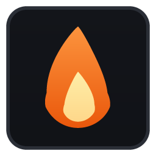
  <h1>焰之契约者 · Flame Contractor</h1>
  <p><strong>你与它立下契约，每日以一言续之，焰不可熄。</strong></p>
  <p>
    本机优先的多端抖音「续火」工具：支持 <strong>Android 独立客户端</strong>、<strong>Windows 桌面端（安装/便携版）</strong> 与 <strong>Docker 多架构容器</strong>。<br />
    所有业务数据、登录态与浏览器 Profile 都留在你自己的设备上，没有云端账号，也没有第三方业务服务器。
  </p>
  <p>
    <a href="https://github.com/oinzc/flame-contractor/releases"></a>
    <a href="https://github.com/oinzc/flame-contractor/actions/workflows/ci.yml"></a>
    <a href="https://github.com/oinzc/flame-contractor/actions/workflows/ci-android.yml"></a>
    <a href="https://github.com/oinzc/flame-contractor/pkgs/container/flame-contractor"></a>
    <a href="LICENSE"></a>
  </p>
  <p>
    
    
    
  </p>
  <p>
    <a href="#三端选型与获取">三端下载</a> ·
    <a href="#为什么做它与典型场景">使用场景</a> ·
    <a href="#界面一览">界面一览</a> ·
    <a href="#核心特性">核心特性</a> ·
    <a href="#安全边界与原理">安全边界</a> ·
    <a href="#快速开始">快速开始</a> ·
    <a href="#品牌设计与更新日志">品牌设计</a> ·
    <a href="CHANGELOG.md">更新日志</a>
  </p>
</div>

> [!NOTE]
> **适用范围：单人、少量好友、低频发送。** 本项目面向个人日常续火，不是群发系统，也不是营销或养号工具。

---

## 三端选型与获取

| 运行端 | 适用场景 | 分发产物 / 获取方式 | 核心特点 |
| :--- | :--- | :--- | :--- |
| **Android 独立客户端** | 手机 / 平板脱离电脑与服务器独立运行 | [GitHub Releases](https://github.com/oinzc/flame-contractor/releases/latest)：`FlameContractor-*-android-universal-release.apk`<br>（附 `SHA256SUMS-android.txt` 与应用内自动更新） | 默认极简模式 + `极简 \| 标准` 弹簧滑块、5 款原生桌面小组件、手机/平板横竖屏自适应、息屏离屏执行 |
| **Windows 桌面端** | 电脑日常开机自用、免装 Docker/Python/Node | [GitHub Releases](https://github.com/oinzc/flame-contractor/releases/latest)：`Flame.Contractor_*_x64-setup.exe`（安装版） / `FlameContractor-*-windows-x64-portable.zip`（便携版）<br>（附 `SHA256SUMS-windows.txt`） | 免登随机握手令牌、复用本机 Edge/Chrome、系统托盘最小化保活、升级不丢同目录 `data/` |
| **Docker 多架构容器** | NAS / 云主机 / 家庭服务器 24 小时常驻 | `ghcr.io/oinzc/flame-contractor:latest`<br>（同时支持 `linux/amd64` 与 `linux/arm64`） | 内置 Chromium 与定时调度、本地仅监听 `127.0.0.1`、与手机/桌面支持 `.zip` 含图无损互迁 |

---

## 为什么做它与典型场景

平时有不少朋友与群聊需要维系抖音火花，每天打开 App 一个个点开对话框不仅繁琐，一忙起来还很容易漏掉导致断火。**焰之契约者** 就是为了解决这个真实痛点而开发——把繁琐、重复但需要长期保持的每日问候，交给可审计、可防错的本地自动化守护进程：

- **💻 场景一｜公司 / 家用电脑托盘静默运行（Windows 桌面版 / 本地 Docker）**：如果你平时上班有开着的公司电脑或家里常开的主机，安装 Windows 版（支持安装包或绿色便携 `.zip`）或跑一个本地 Docker 容器即可；设置好发送窗口后缩小到系统托盘，到点自动续火，不占用手机也不用手动盯着。
- **📱 场景二｜主力机或备用 Android 手机 / 平板（设置一次、熄屏放着即可）**：下载独立版 Android APK 后，跟着 7 步新手向导完成一次账号登录与权限放行（如关闭省电限制、小米 / HyperOS 放行自启动与后台弹出界面），日常就可以直接放在一边，**无需一直亮屏或把软件挂在前台**，系统会在设定时间自动唤醒并完成续火。
- **🐳 场景三｜NAS / 家庭服务器 24 小时托管**：在群晖、飞牛、Unraid 或云主机上通过 Docker Compose 常驻运行，Web 控制台随时查看执行回执与 30 天趋势；如果需要在电脑与手机之间切换主力设备，还能直接导出含自定义图片在内的 `.zip` 迁移包无缝接力。

---

## 界面一览

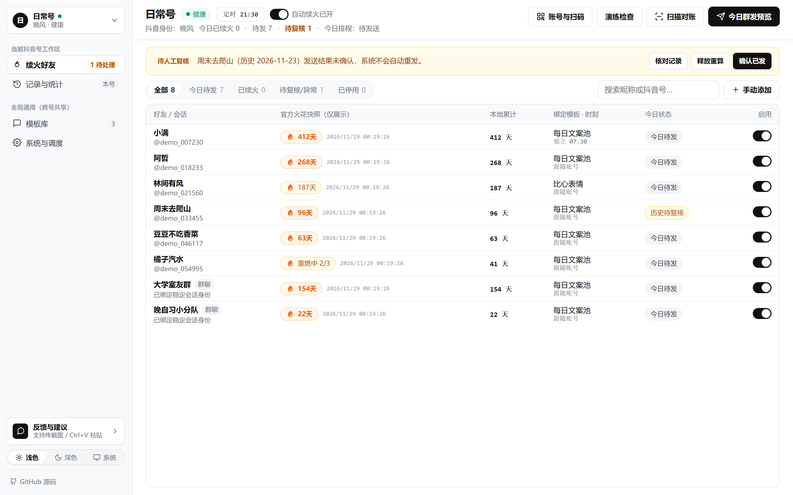

<sub>本文所有界面展示图均来自内置<a href="#进阶参考">只读演示实例</a>的虚构数据（日常号 · 晚风 / 小满 / 阿哲等），与任何真实账号或好友无关。</sub>

### Android 独立客户端与 5 款原生桌面小组件

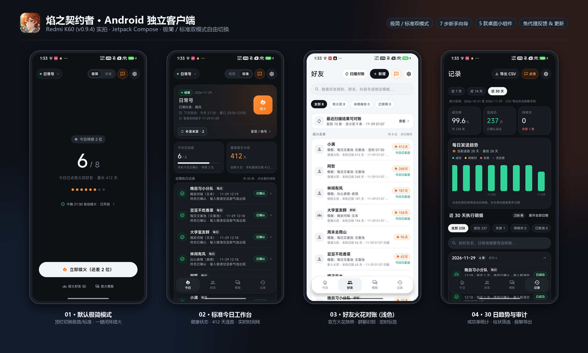

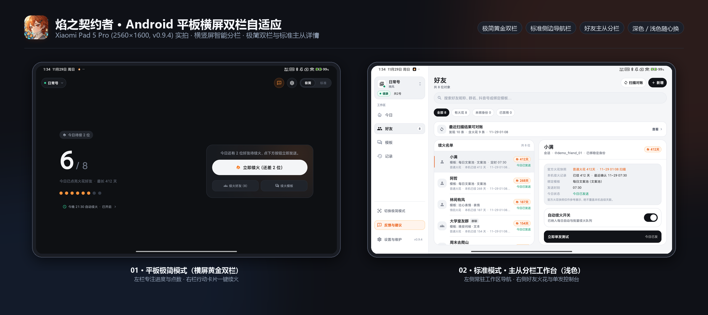

- **极简 / 标准双模式顶栏直切**：默认**极简模式**专注日常核心动线（今日待续计数、点亮进度圆点与单手主按钮一键续火）；点击顶栏 `极简 | 标准` 双段胶囊即可丝滑切换至完整四栏工作台（今日 / 好友 / 模板 / 记录），并在手机与平板横竖屏间自适应分栏。
- **7 步强制新手向导 & 熄屏定时唤醒**：逐项引导并实时检测权限（含小米 / HyperOS「自启动 `10008`」与「后台弹出界面 `10021`」），一次设置即可熄屏日常运行；原生支持跳转本机抖音确认登录并极速回跳，多账号按 WebView Profile 并发隔离且自动同步真实昵称。
- **免代理自动更新与历史日志**：支持冷启动静默检测更新与「设置 → 应用版本与更新」手动检查，可直连展开跨版本跳过历史变更；流式校验 SHA-256 后调起系统覆盖安装，完整保留账号与好友数据。

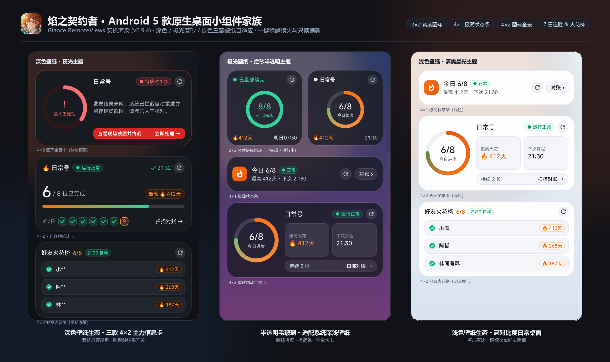

- **5 款尺寸自由组合 & 4 种独立外观**：涵盖 `2×2` 进度圆环、`4×1` 极简状态条、`4×2` 圆环全景 / 7 日连胜 / 好友火花榜，零新增依赖原生绘制；可在设置中独立切换「跟随 App / 深色碳黑 / 浅色纯白 / 半透明深色玻璃」，支持好友首字隐私脱敏、防重复一键上桌与 60fps 旋转刷新回执。

### Windows 桌面端 / Web 控制台

<table>
  <tr>
    <td width="50%">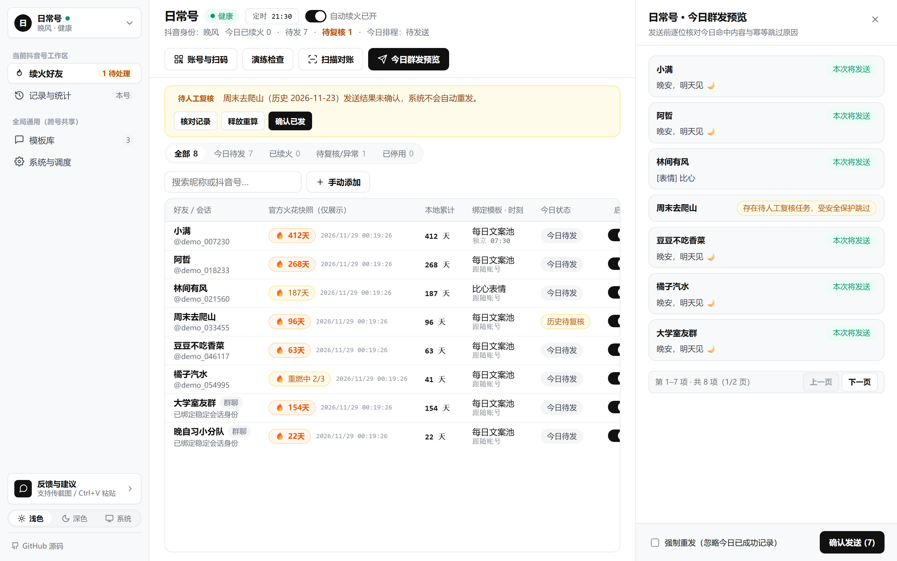<br><b>今日群发预览抽屉</b>：发送前在右侧逐位核对今日队列、渲染文案与幂等/复核跳过原因，确认后才执行。</td>
    <td width="50%">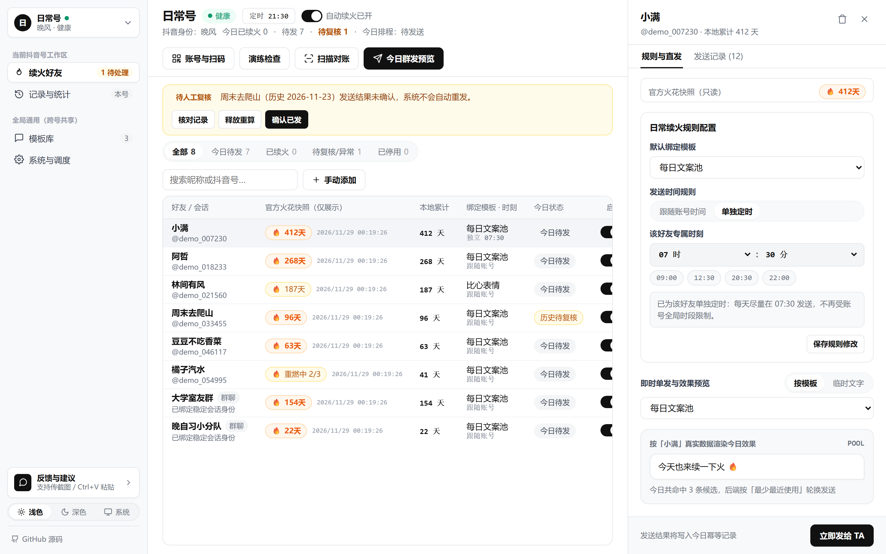<br><b>好友详情与规则抽屉</b>：点击任意好友即可在右侧查看稳定平台身份、官方火花快照，绑定模板或单独设定发送时刻。</td>
  </tr>
  <tr>
    <td>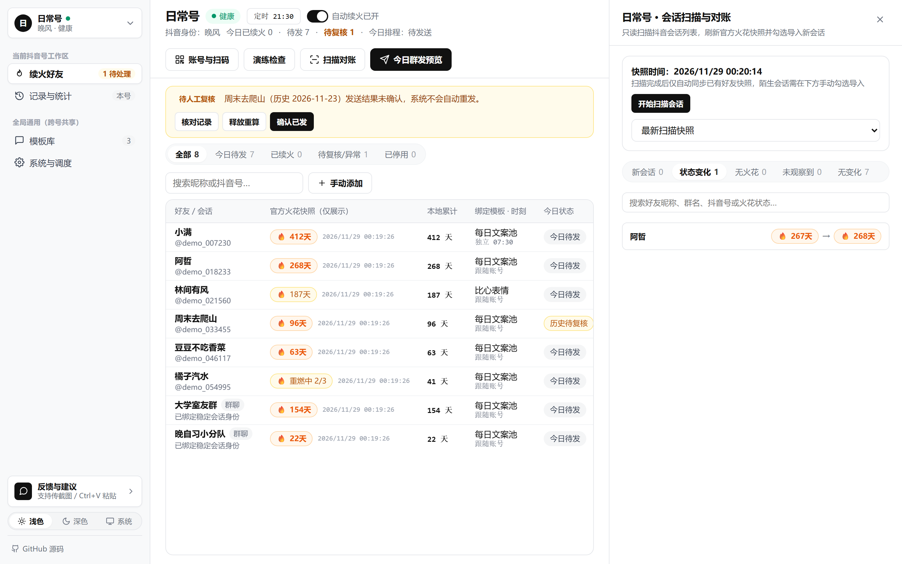<br><b>扫描对账抽屉</b>：只读同步官方状态，按新会话 / 状态变化 / 无火花 / 未观察到 / 无变化五类归档并手动确认。</td>
    <td>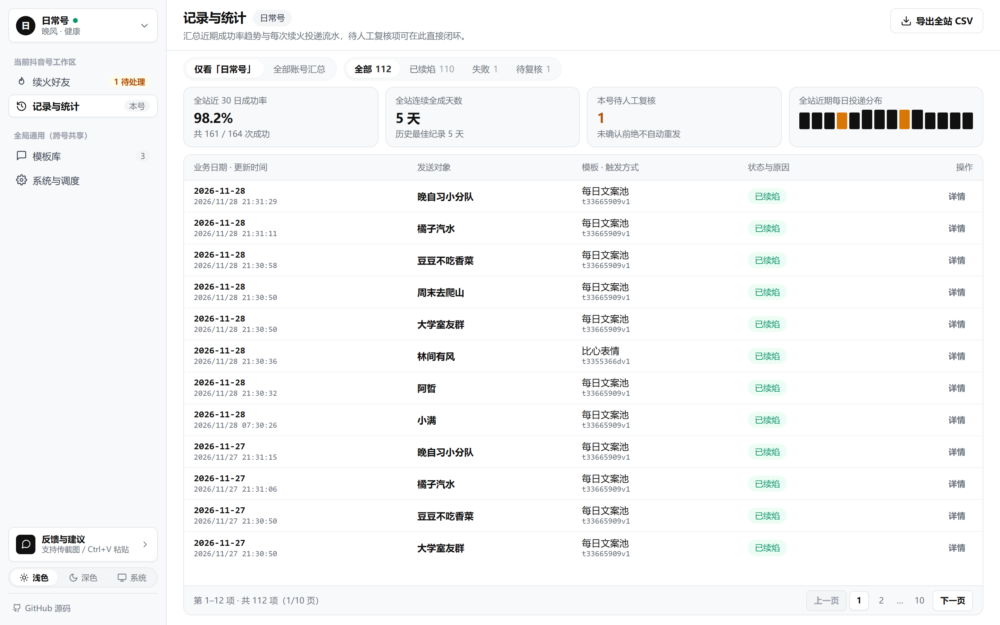<br><b>记录与统计</b>：汇总近 30 日成功率与连续成功天数，结果无法确认的任务单独筛出，等你人工复核。</td>
  </tr>
  <tr>
    <td colspan="2">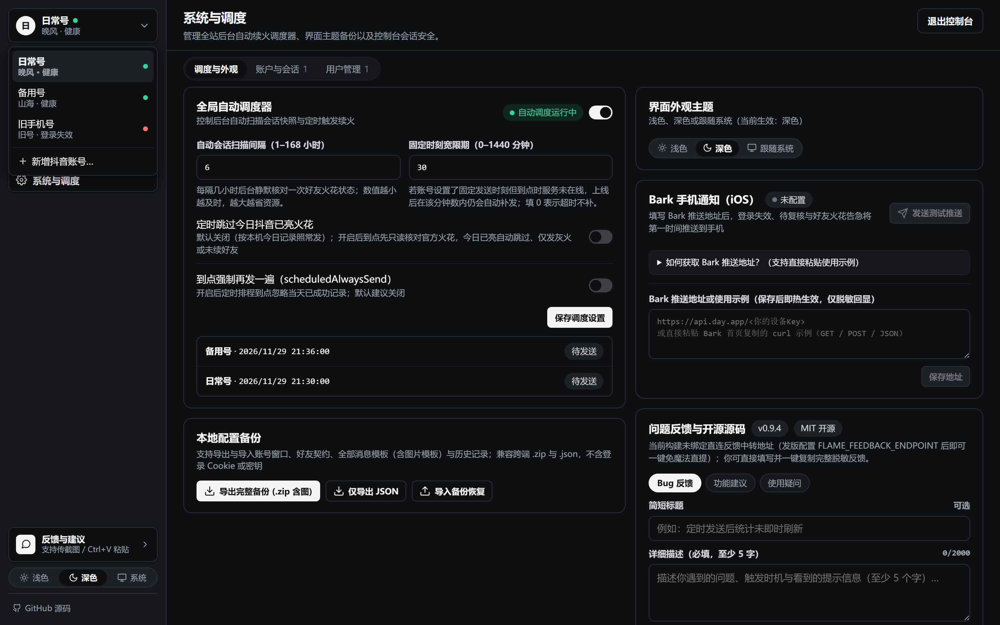<br><b>多账号切换、系统调度与三态主题</b>：左上角秒切各自独立浏览器 Profile 的抖音账号（失效账号醒目标红并停发），支持浅色 / 深色 / 跟随系统无闪烁切换、24 小时结构化闹钟选时、「跳过今日抖音已亮火花」开关、Bark 内联配置、<code>.zip</code> 含图备份恢复与应用内 <code>Ctrl+V</code> 贴图反馈。</td>
  </tr>
</table>

---

## 核心特性

- **宁可不发，不可错发（发送安全与精准定位）**
  - **严格身份消歧**：好友按 `platform_user_id`、群聊按 `platform_conversation_id`（含多通道捕获校验），两类身份绝不混用。
  - **同日幂等 & 终态确认**：同一天同一好友按账号自然日最多累计 `+1`；到点抢租约真实发送并确认输入框清空且新气泡出现，结果存疑时记为「待人工复核 (`UNKNOWN_REQUIRES_REVIEW`)」并留存现场截图，**人工终裁前绝不自动重发**。
  - **官方火花只读对账**：完整识别全部 6 类抖音官方火花图标与今日亮/灰状态，绝不伪造或覆写本地 `streak_days`；三端均提供可选开关「定时跳过今日抖音已亮火花（默认关闭）」。
- **极简上手与闹钟式调度**
  - **多账号 Profile 隔离**：一台设备管理多个抖音号，登录态、窗口时刻与通知完全隔离；扫码支持有头窗口、手机跳转与容器内「截图扫码」。
  - **24 小时闹钟式选时与大白话调度**：全端采用结构化滚轮 / 下拉选时（「时间段内自动发 / 每天固定时刻发」二选一 + 实时人话生效说明），彻底告别手输冒号格式错误；内置固定文案、星期轮换 LRU 文案池、去 EXIF 本地图片与抖音原生表情模板。
- **三端独立运行与无损 `.zip` 互迁**
  - 支持含去 EXIF 图片模板的标准 `.zip` 完整备份包与 `.json` 双向无损互迁（严格剥离登录 Cookie 与 Bark 密钥）。
  - 接入 Bark 分级推送与 Android 本机通知，第一时间提醒登录失效、待人工复核与官方火花告急。
- **可观测审计、免魔法反馈与原创品牌视觉**
  - 保留失败 / 待复核现场截图灯箱与 30 日趋势审计；内置零副作用页面结构体检与定位词热覆写。
  - 全端 1 步直达国内免代理带图反馈入口（Web/桌面支持 `Ctrl+V` 贴图与拖拽，Android 自动脱敏型号与 ROM 日志），无需登录 GitHub 即可提交 Issue；全端应用名称统一为「**焰之契约者**」，搭载全新原创角色品牌图标（[查看设计演进记录](docs/BRAND_ICON_DESIGN_LOG.md)）。

---

## 安全边界与原理

### 一次发送是怎样完成的

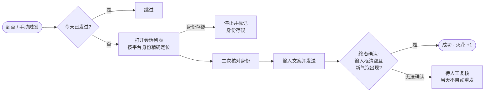

登录失效、网络不可用、页面结构变化也都会在发送前或发送中拦下，并通过 Bark 或系统通知推送提醒。

### 它不做什么

> [!CAUTION]
> - 不提供批量群发、自动加好友、自动回复、爬取他人资料。
> - 不做多账号养号、对抗平台风控或绕过验证码。
> - 不保证在平台改版后立即可用；选择器与页面结构变化时可能需要更新。
> - 不提供云托管；没有多租户、计费或远程访问。

---

## 快速开始

### 1. Android 独立客户端（手机 / 平板免电脑）

- **系统要求**：Android 8.0+（`minSdk 26`），并保持系统 **Android System WebView** 为较新版本。
- **安装使用**：
  1. 前往 [GitHub Releases](https://github.com/oinzc/flame-contractor/releases/latest) 下载 `FlameContractor-*-android-universal-release.apk`（支持通过同目录 `SHA256SUMS-android.txt` 核对完整性）。
  2. 首次启动跟随 **7 步向导**完成通知、精确闹钟、电池优化、自启动与后台弹出界面授权（最后一步默认推荐「极简模式」，之后可在顶部胶囊随点切换）。
  3. 点击一键跳转本机抖音确认登录，扫描导入好友后即可在「好友 / 模板 / 发送时间」完成配置；如需桌面状态卡片，在「设置 → 桌面小组件中心」一键防重复添加。
  4. **零打扰保活**：由 `AlarmManager` + 30 分钟 `WorkManager` 兜底拉起短时离屏 `dataSync` 服务，息屏状态下静默发火并自动释放，留存 7 天失败/待复核截图供灯箱核对。

<details>
<summary><b>展开：本地自行构建 Android APK（JDK 17 + Android SDK 35）</b></summary>

```bash
cd android
./gradlew verifySelectorBundleSync :app:testDebugUnitTest :app:lintDebug :app:assembleDebug
# 调试 APK 输出在 android/app/build/outputs/apk/debug/app-debug.apk
# 也可构建未签名 Release APK：./gradlew :app:assembleRelease
```

</details>

### 2. Windows 桌面端（免 Docker，安装/便携双版本）

1. 在 [GitHub Releases](https://github.com/oinzc/flame-contractor/releases/latest) 按需选择：
   - **标准安装版**（`Flame.Contractor_*_x64-setup.exe`）：免管理员权限双击即装；
   - **绿色便携版**（`FlameContractor-*-windows-x64-portable.zip`）：解压到任意可写目录后双击 `Flame Contractor.exe` 即用，删目录即卸载。
   - 两个版本均附带 `SHA256SUMS-windows.txt`；首次运行如遇 Windows SmartScreen 提示，点「更多信息 → 仍要运行」。
2. 打开后自动单机免登（随机 64 位握手令牌保护 `127.0.0.1` 本地接口，优先复用本机 Edge / Chrome），按首屏引导完成「扫码 → 扫描对账 → 绑定模板与闹钟」。
3. 点击右上角 `×` 最小化到右下角系统托盘持续保活（右键托盘「彻底退出」才停后端）；数据默认保存在软件同目录 `data/` 下（只读目录自动回退 `%LOCALAPPDATA%\FlameContractor`），升级不丢数据。

> 电脑休眠或关机期间无法定时发送；需要 24 小时关电脑也续火的场景，推荐使用下方 Docker 部署。

<details>
<summary><b>展开：本地自行构建 Windows 安装包与便携版（Node 22 + Python 3.12 + Rust）</b></summary>

```powershell
cd frontend && npm ci && npm run build && cd ..
backend\.venv\Scripts\python.exe -m pip install -r backend\requirements-desktop.txt
backend\.venv\Scripts\python.exe scripts\build_desktop_backend.py
cd desktop && npm ci && npm run build
# NSIS 安装包输出在 desktop/src-tauri/target/release/bundle/nsis/
```

</details>

### 3. Docker（服务器 / NAS / 24 小时常驻）

官方预构建镜像 `ghcr.io/oinzc/flame-contractor:latest` 原生支持 `linux/amd64` 与 `linux/arm64`，内置 Chromium，宿主机无需安装浏览器。

1. 准备 `.env`（`FLAME_SECRET_KEY` 至少 32 位随机字符；Linux 请执行 `chown 10001:10001 .env && chmod 600 .env` 确保非 root 容器可读）：
   ```ini
   FLAME_SECRET_KEY=请替换为至少32位随机字符串
   FLAME_BARK_URL=
   ```
2. 准备 `compose.yaml`：
   ```yaml
   name: flame-contractor
   services:
     app:
       image: ghcr.io/oinzc/flame-contractor:latest
       init: true
       restart: unless-stopped
       stop_grace_period: 60s
       shm_size: 512mb
       ports:
         - "127.0.0.1:${FLAME_HOST_PORT:-8000}:8000"
       volumes:
         - data:/app/data
         - artifacts:/app/artifacts
         - type: bind
           source: ./.env
           target: /app/backend/.env
           read_only: true
           bind:
             create_host_path: false
       logging:
         driver: json-file
         options:
           max-size: "10m"
           max-file: "3"
   volumes:
     data:
     artifacts:
   ```
3. 启动并打开 <http://127.0.0.1:8000/> 创建管理员，通过「账号与扫码」截图扫码登录、扫描导入好友即可；升级与健康检查：
   ```bash
   docker compose up -d
   docker compose pull && docker compose up -d
   curl http://127.0.0.1:8000/health   # 期望 {"status":"ok","database":"ready",...}
   ```

<details>
<summary><b>展开：克隆源码本地 Docker 构建</b></summary>

```bash
git clone https://github.com/oinzc/flame-contractor.git
cd flame-contractor
cp .env.example .env
python -c "import secrets; print(secrets.token_urlsafe(32))"   # 填入 FLAME_SECRET_KEY
docker compose up -d --build
```

</details>

---

## 进阶参考

<details>
<summary><b>免账号只读演示实例（本地预览控制台界面）</b></summary>

不想登录抖音也不想开 Docker，可直接启动内置只读演示实例（数据独立存放在 `data/demo/`，禁用发送/扫描，除登录外写操作一律返回 403）：

```bash
cd frontend && npm ci && npm run build && cd ..
cd backend
python -m venv .venv
.venv/Scripts/python.exe -m pip install -r requirements-dev.txt   # Linux/macOS 用 .venv/bin/python
.venv/Scripts/python.exe scripts/demo_server.py
```

打开 <http://127.0.0.1:8010/>，使用 `demo` / `demo-password` 登录（加 `--reseed` 可重置演示数据）。

</details>

<details>
<summary><b>环境变量配置表（全部以 FLAME_ 开头）</b></summary>

Docker 部署写在同目录 `.env` 中（只留本机，已被 git 忽略）：

| 变量 | 默认值 | 说明 |
| --- | --- | --- |
| `FLAME_SECRET_KEY` | 无（必填） | 会话签名密钥，至少 32 位；容器启动时会校验 |
| `FLAME_SERVE_FRONTEND` | `true`（镜像内） | 由后端直接托管前端静态文件 |
| `FLAME_BARK_URL` | 空 | 可选，Bark 推送地址 `https://api.day.app/<device_key>`；留空则不推送 |
| `FLAME_WINDOW_EXPIRY_POLICY` | `skip` | 错过发送时刻：`skip` 不再补发，`dispatch` 到点即发 |
| `FLAME_FIXED_TIME_GRACE_MINUTES` | `30` | 固定时刻的宽限期（分钟），`0` 表示不宽限 |
| `FLAME_AUTH_CHECK_TOLERANCE` | `2` | 连续多少次登录判定失败才标记失效 |
| `FLAME_LOGIN_CHECK_TIMEOUT` | `20` | 登录判定时等待会话列表出现的秒数 |
| `FLAME_SCAN_TIMEOUT_SECONDS` | `600` | 单次会话扫描的总预算，超时释放「扫描中」占用 |
| `FLAME_AUTO_SCAN_INTERVAL_HOURS` | `24` | 自动同步会话状态的初始周期（之后可在控制台调整） |
| `FLAME_SCHEDULED_ALWAYS_SEND` | `false` | 到点是否忽略当天已发送记录再发一次（首次初始化默认值） |
| `FLAME_HOST_PORT` | `8000` | Compose 映射到宿主机的端口（仅绑定 `127.0.0.1`） |

`FLAME_DATABASE_URL`、`FLAME_PROFILES_DIR`、`FLAME_ARTIFACTS_DIR` 一般无需改动，容器内默认落于 `/app/data` 与 `/app/artifacts`。

</details>

<details>
<summary><b>数据目录、命名卷与跨端无损备份说明</b></summary>

- **业务库与登录态**：Docker 下 SQLite 位于 `flame-contractor_data` 卷（`/app/data/flame-contractor.db`），登录态位于同卷 `profiles/`，截图位于 `flame-contractor_artifacts`；更新请使用 `docker compose down`，**切勿使用 `docker compose down -v`**。
- **三端互迁**：控制台「系统与调度 → 本地配置备份」与 Android「设置 → 数据备份与迁移」均支持导出/导入含去 EXIF 图片模板的标准 `.zip` 完整包与 `.json` 备份（均不含登录态与 Bark 密钥）。

</details>

<details>
<summary><b>本地开发、测试命令与仓库目录结构</b></summary>

```bash
# 后端开发与全量测试（无需真实浏览器）
cd backend
python -m venv .venv
.venv/Scripts/python.exe -m pip install -r requirements-dev.txt
.venv/Scripts/python.exe -m pytest -q

# 前端开发、领域单测与构建
cd frontend
npm ci
npm run dev      # http://localhost:5173，已代理 /api 与 /health
npm test         # node --test 领域纯函数单测
npm run build    # tsc --noEmit && vite build

# 发版与图标工具脚本测试（根目录）
python -m unittest discover -s scripts -p "test_*.py" -v
```

```text
backend/    FastAPI + SQLModel + SQLite + Alembic + asyncio 调度 + Playwright
frontend/   React + TypeScript + Vite 控制台
desktop/    Tauri v2 Windows 独立窗口桌面壳与 NSIS 打包配置
android/    Kotlin + Jetpack Compose + Room + 桌面模式 WebView 独立 Android 客户端
scripts/    全端版本同步、三端图标生成、Windows 便携包与校验和、Android 清单脚本
docs/       PRD、技术设计、API/Schema、Docker 部署、品牌图标演进记录与反馈中转脚本
```

</details>

<details>
<summary><b>常见问题（FAQ）</b></summary>

- **扫码后一直停在加载？** 抖音静态资源在国内 CDN，跨境网络会让登录页渲染很慢。优先在本机 Android / Windows 或国内 Docker 运行，不建议放在海外服务器。
- **提示登录失效，但手机端正常？** 页面结构或会话加载超时可能误判；连续失败达到 `FLAME_AUTH_CHECK_TOLERANCE` 才会标记失效。重新扫码即可恢复，自动调度会在恢复后继续。
- **凌晨没发出去？** 检查发送时刻是否落在账号窗口内，以及 `FLAME_FIXED_TIME_GRACE_MINUTES` 是否给足；`skip` 策略下错过时刻不会补发（Android 手机请检查 7 项权限清单中的自启动与后台弹出是否放行）。
- **能不能多台机器同时跑？** 不建议。同一账号的浏览器 Profile 不能被两个进程同时使用。

</details>

---

## 品牌设计与更新日志

- **全新原创品牌图标**：经过 16 步解耦组件打磨与零漂移校验，定稿采用 **「朝阳琉璃宝石玫瑰窗（SG-F3）」**，已同步覆盖 Windows 桌面/托盘、Web 标签页与登录页、Android 自适应安全区图标 —— 完整过程与演进全景见 [品牌图标设计与演进记录](docs/BRAND_ICON_DESIGN_LOG.md)。
- **历史版本变更**：全部版本说明与跨版本细节见 [CHANGELOG.md](CHANGELOG.md)。

---

## 问题反馈与开源协作

欢迎所有想法、体验吐槽与功能建议——不管你平时用哪一端，都可以通过下面任一渠道告诉作者：

1. **软件内一键直连反馈（最推荐，免代理、免登录）**：Android 端点击顶栏右上角反馈图标（或「设置 → 反馈与建议」），桌面端与 Web 控制台点击侧边栏底部「反馈与建议」（支持拖拽与 `Ctrl+V` 贴图）。无需登录或配置 GitHub，即可附带最多 3 张自动去 EXIF 截图与脱敏环境摘要，直达作者仓库。
2. **新想法与产品讨论 → [GitHub Discussions](https://github.com/oinzc/flame-contractor/discussions)**：适合发散性脑暴、新平台支持探讨、使用技巧分享或「我想有某个模式/工作流」类长期话题。
3. **明确 Bug 与功能需求 → [GitHub Issues](https://github.com/oinzc/flame-contractor/issues/new/choose)**：内置「缺陷反馈 / 功能建议」表单模板；遇到发送识别异常或适配问题时，带上脱敏日志摘要或截图能最快帮你定位。
4. **代码贡献与自建反馈中转**：欢迎直接提 Pull Request，协作约定见 [CONTRIBUTING.md](CONTRIBUTING.md)；Fork 本仓库后如需独立接收反馈，可按 [docs/feedback-relay/README.md](docs/feedback-relay/README.md) 部署零依赖 Cloudflare Worker。

## 免责声明与开源协议

本项目与抖音（字节跳动）无任何关联，未获其授权或认可。它通过浏览器自动化操作真实账号，**可能违反平台服务条款**，存在账号被限制的风险；请仅用于自己的账号与少量真实好友，不要用于骚扰、营销或批量操作。使用风险由你自行承担，作者不对账号损失、数据丢失或任何间接损失负责。

基于 [MIT](LICENSE) 协议开源。
