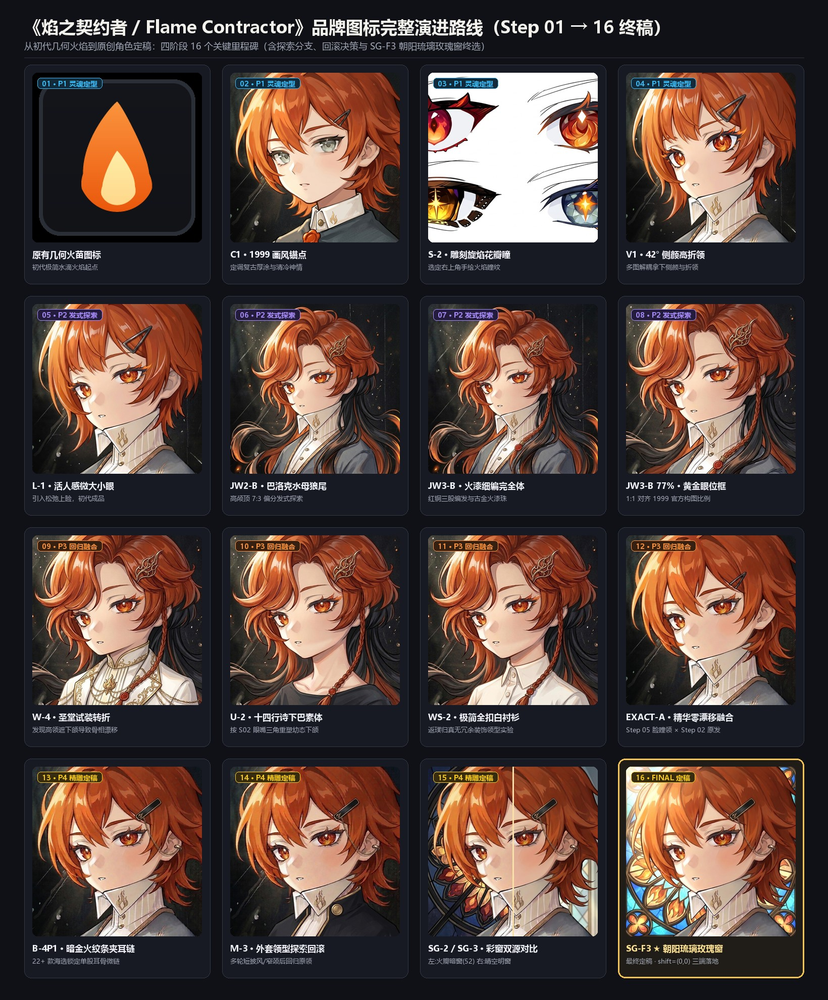
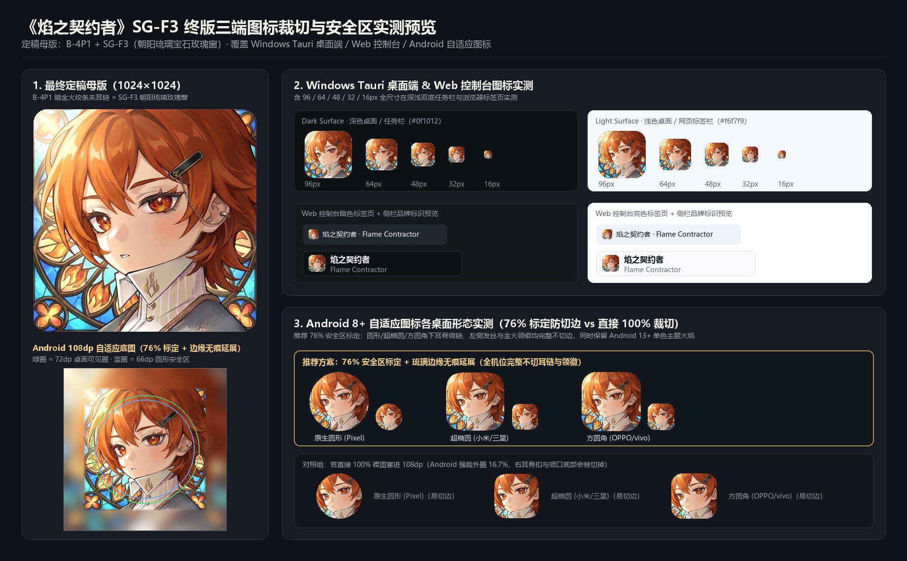

# 品牌图标设计与演进记录（Flame Contractor · 焰之契约者）

本文档记录《焰之契约者 / Flame Contractor》品牌图标从初代几何水滴火焰演进至原创二次元品牌角色母版 **`B-4P1 × SG-F3`（朝阳琉璃宝石玫瑰窗）** 的完整设计脉络、历次分支探索与回滚决策、零漂移验收数据，以及 Windows / Web / Android 三端落地规范。

## 一、全链路 16 步演进全景



## 二、四阶段里程碑与关键变更决策

### Phase 1 · 灵魂定型（Step 01 → 04）

| 步骤 | 代号 | 核心变更与拍板结论 |
| :---: | :--- | :--- |
| **01** | **几何火焰起点** | 原有纯 Python 生成的碳黑圆角底板 + 暖橙水滴火焰图标，启动品牌人格化升级。 |
| **02** | **C1 · 1999 画风锚点** | 确立复古学院厚涂质感、短中庭比例与清冷微张唇神情（明确否决甜美微笑路线），并成为后续最终发型的轮廓母本。 |
| **03** | **S-2 · 雕刻旋焰花瓣瞳** | 调研日系沾水笔插画质感，定制 4 套火焰瞳方案并拍板 **S-2 旋焰花瓣瞳**。 |
| **04** | **V1 · 42° 侧颜高折领** | 通过多图结构解耦迁移，确立 42° 侧头回眸姿态、贴颌白竖条纹金火徽高折领与 S-2 焰瞳的首次融合。 |

### Phase 2 · 活人感与发式探索（Step 05 → 08）

| 步骤 | 代号 | 核心变更与拍板结论 |
| :---: | :--- | :--- |
| **05** | **L-1 · 电影感微大小眼** | 引入二游角色头像的微大小眼与松弛上睑，消除机械对称感，形成初代成品锚点。 |
| **06** | **JW2-B · 巴洛克水母狼尾** | 尝试拉远 12% 高颅顶留白、7:3 大偏分水母层次与炭黑内衬狼尾。 |
| **07** | **JW3-B · 火漆细编完全体** | 在巴洛克发式基础上迭代耳后三股红铜细编发、火纹发夹与古金火漆珠装饰。 |
| **08** | **JW3-B 77% · 黄金眼位框** | 按《重返未来：1999》官方图标眼位坐标标定出 `77%` 黄金构图裁切比例。 |

### Phase 3 · 骨相验证与精华融合（Step 09 → 12）

| 步骤 | 代号 | 核心变更与拍板结论 |
| :---: | :--- | :--- |
| **09** | **W-4 · 圣堂白金试装转折** | 礼服换装暴露“高领遮挡下颌导致下巴与肩颈容易漂移”的结构隐患，促使回归素体做骨相核查。 |
| **10** | **U-2 · 幼态短圆下巴素体** | 实网检索十四行诗官方露下巴立绘 `S02`，按眼—嘴三角 1:1 对齐校准幼态短圆下巴与极细前收颈柱。 |
| **11** | **WS-2 · 极简全扣白衬衫** | 验证极简全扣暖白衬衫与原发搭配；对比评估后决定回归更具辨识度与复古厚涂凝聚力的经典组合。 |
| **12** | **EXACT-A · 精华零漂移融合** | 将 **Step 05 的活人感焰瞳、清冷神情与高折领** 与 **Step 02 的完整原发轮廓** 精准合并并三项微修，确立最终角色主体基座。 |

### Phase 4 · 配饰精雕、服装回滚与彩窗终稿（Step 13 → 16）

| 步骤 | 代号 | 核心变更与拍板结论 |
| :---: | :--- | :--- |
| **13** | **B-4P1 · 暗金火纹条夹耳链** | 历经 22+ 款发饰海选（`A-1~A-8`、`B-1~B-8`、实网二游发饰对标 `W-1~W-3` 与 `B-4` 三版精修），最终锁定 **哑光黑金边微雕小火焰长条发夹 + 单股超细古金耳骨微链 + 迷你耳骨扣**，既增亮点又不压脸。 |
| **14** | **M-3 · 外套与领口探索回滚** | 依次测试礼服外套（`O-1~O-4` / `O-1B~D`）、简约贴肩（`S-1~S-4`）、无扣纯线/贴肩圆扣短披风（`M-1~M-3`）、领口工艺精修（`C-1~C-3`）与 1999 窄后颈蓝图（`N-1~N-4`）；复盘实测后确认 **回滚至 `B-4P1` 原版白竖条纹金火徽高折领** 整体协调度最高。 |
| **15** | **SG-2 / SG-3 · 哥特彩窗双源对照** | 否决过平的纯色渐变背景（`BG-1~BG-3`）；实网调研 12 款二游 App 图标背景墙后选定 **哥特彩窗**，并确立融合方向：保留 **`SG-2` 烈焰花瓣玫瑰窗** 的契约主题，同时吸收 **`SG-3` 晴空教堂彩窗** 的晨光明亮通透感（解决 `SG-2` 背景明度 `52.3` 偏阴暗的问题）。 |
| **16** | **SG-F3 ★ 朝阳琉璃宝石玫瑰窗（终稿）** | 融合生成 `SG-F1 / SG-F2 / SG-F3` 三档晨光烈焰玫瑰窗，最终拍板 **`SG-F3`（朝阳琉璃宝石玫瑰窗 · 饱满透光版）**：左下背景明度由 `52.3` 提升至 **`136.7`（2.6× 提亮）**，透光钴蓝琉璃与炽金火舌花瓣在深浅双底均极富火彩，人物位移实测 **`shift=(0, 0)`** 零漂移。 |

---

## 三、三端裁切与安全区落地规范



### 1. 统一母版与一键复现

- **无损定稿母版**：[`scripts/assets/brand-icon-master.png`](../scripts/assets/brand-icon-master.png)（`1024×1024` RGBA PNG）
- **三端生成脚本**：[`scripts/generate_desktop_icons.py`](../scripts/generate_desktop_icons.py)

```powershell
# 一键重新生成 Windows Tauri / Web / Android 全量图标
python scripts/generate_desktop_icons.py

# 或仅生成指定端
python scripts/generate_desktop_icons.py --targets desktop web
```

### 2. 各端交付产物与技术规格

| 平台 | 产物路径 | 关键规格与防切边策略 |
| :--- | :--- | :--- |
| **Windows Tauri 桌面端** | `desktop/src-tauri/icons/{32x32,128x128,128x128@2x,icon}.png`<br>`desktop/src-tauri/icons/icon.ico` | 4× 超采样抗锯齿圆角（`22%` 圆角，小尺寸 `16/24px` 为 `18%` 无描边；`≥28px` 附 `1px` 柔白内描边）；多帧 PNG-in-ICO（`16/24/32/48/64/128/256`）；同时自动驱动 Tauri 系统托盘图标。 |
| **Web 控制台** | `frontend/public/{favicon.ico,favicon-32x32.png,apple-touch-icon.png,brand-icon-512.png}`<br>`frontend/index.html`<br>`frontend/src/components/views/LoginView.tsx` | 替换原内联 `🔥` Emoji favicon；`apple-touch-icon.png`（`180×180`）保持全出血直角以适配 iOS/macOS 自动裁切；登录页 `.fc-auth-mark`（`38×38`）同步接入 `brand-icon-512.png` 并兼容浅色/深色碳黑双主题。 |
| **Android 8+ 独立端** | `android/app/src/main/res/mipmap-{mdpi,hdpi,xhdpi,xxhdpi,xxxhdpi}/ic_launcher_foreground.png`<br>`android/app/src/main/res/drawable/ic_launcher_background.xml`<br>`android/app/src/main/res/mipmap-anydpi-v26/ic_launcher{,_round}.xml` | 严格采用 **`76%` 安全区标定 + 琉璃边缘无痕延展**（`432×432` 母帧下采样至全 5 档密度），确保 `72dp` 可见区与 `66dp` 圆形安全区在原生圆形、超椭圆、方圆角及桌面视差晃动下完整保留双眼、耳链与领口金火徽；背景底色更新为 `#152236`，保留 Android 13+ Material You `@drawable/ic_launcher_monochrome` 单色火焰矢量图标。 |
