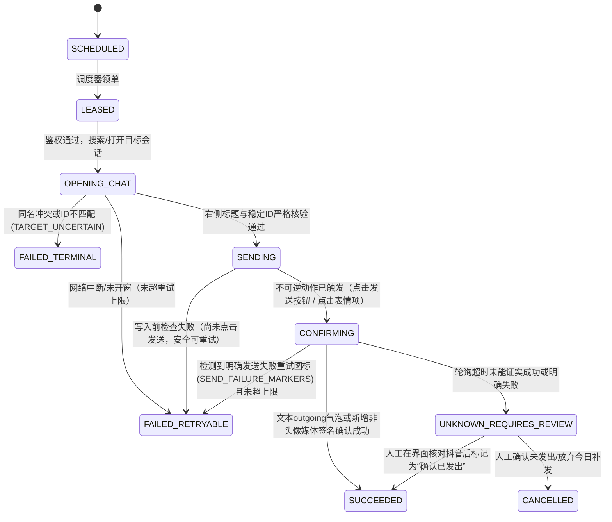

# 抖音续火工（Flame Contractor）独立 Android 版设计规范

- **日期**：2026-11-21
- **状态**：已通过独立构建审查并修订，待你最终确认（已完成真机 Spike 实证；尚未进入实施编码）
- **仓库位置**：拟落地于 `android/`（与 `backend/`、`frontend/`、`desktop/` 并列）
- **目标产物**：完全独立运行的开源 Android 安装包（`.apk`），不依赖 PC 端、Docker 或自建后端服务

---

## 1. 背景与目标（Intent & Why）

桌面版与 Docker 版抖音续火工已可稳定在本地或服务器上运行，但许多用户希望直接用一部闲置手机、备用平板或主力 Android 设备独立完成每日自动续火，无需电脑长期开机或购买云服务器。

独立 Android 版的本质不是「远程遥控桌面端」，而是将现有的**安全状态机、身份唯一性核验、官方火花探测、确定性/容错发送确认以及本地调度能力**完整下沉到 Android 本机：用户扫码登录一次抖音网页端后，App 在本地 SQLite 维护续火对象与文案模板，到点通过短时前台服务内的离屏桌面模式 `WebView` 静默执行续火，并在异常或完成时通过本机通知或 Bark 主动回音。

---

## 2. 目标、非目标与反目标（Goals / Non-Goals / Anti-Goals）

### 2.1 目标（Goals）
1. **完全单机独立**：所有存储、调度、网络拦截、DOM 交互与推送逻辑全部在 Android App 进程内完成，无需 PC 或外部后端。
2. **轻量开源分发**：复用 Android 系统自带的现代 Chromium WebView 内核，不打入完整浏览器内核，Release `.apk` 体积控制在数 MB～十几 MB，支持 GitHub Releases 公开下载安装。
3. **手机/平板自适应原生体验**：基于 Jetpack Compose + Material 3 构建极简原生界面，适配手机竖屏（`<600dp` 底部导航栏）与平板横/竖屏（`>=600dp` 左侧导航栏）。
4. **继承桌面版全部安全边界**：沿用 `unknown_requires_review` 永不自动重发、`platform_user_id` / `platform_conversation_id` 唯一核验防同名误发、连续鉴权容忍防断网误判失效、官方火花快照不覆写本地统计四大核心守则。
5. **首版闭环消息形态（3A）**：支持固定文本、星期过滤 + LRU 轮换文案池（`pool`），以及抖音原生表情（`sticker`，默认内置「比心」）。
6. **零打扰定时执行与双通道提醒（4A）**：平常不常驻挂机、不控制手机屏幕；每日到点后通过短时 `dataSync` 前台服务 + 离屏桌面模式 `WebView` 安静执行，完成后自动退出；支持 Android 本机系统通知与 Bark 推送（含 `curl` 示例智能解析与脱敏）。
7. **共享定位器契约**：复用 `backend/app/execution/selectors_bundle.json` 作为定位器基线，同步至 Android `assets`，并支持 App 内局部覆写（锁定 `CHAT_URL` 不可改）。

### 2.2 非目标（Non-Goals — 明确不做进首版）
- **多账号切换 UI**：首版专注单账号稳态运行，但 Room 数据模型全表保留 `account_id` 列，为后续接入 `WebView ProfileStore` 多账号隔离留好位置。
- **后台定时自动扫描与「好友火花告急」预警（`auto_scan` / `collect_spark_deteriorations`）**：首版（v1）仅支持在「好友」页手动触发扫描同步与导入对账，周期性后台自动扫描与火花恶化高优提醒作为二期扩展。
- **跨午夜发送窗口与批量强制重发开关**：首版每日发送窗口必须位于同一自然日内（`00:00–23:55`），且不设绕过当日成功记录的批量强制重发开关。
- **本地图片上传发送（`image`）与 AI 生成文案**：首版聚焦文本、文案池与原生表情；图片发送与 AI 文案作为二期扩展。
- **跨设备/云端数据同步**：数据严格保留在本机应用沙盒内。
- **iOS 支持**、**Root/Xposed 注入**、**无障碍模拟点击原生抖音 App**。
- **自动识别/绕过验证码或「身份验证」风控**：遇到扫码风控弹窗或图形验证码时，立即停下并通知用户亲自完成验证。

### 2.3 反目标（Anti-Goals — 绝对禁止发生）
- 定时续火触发时突然弹出全屏页面、拉起外部浏览器/抖音 App 或抢占用户正在使用的输入法焦点。
- 发送动作已触发但无法确认结果时，擅自再次点击发送或按回车重发（宁可记 `unknown_requires_review` 通知人工核对）。
- 仅凭昵称模糊匹配，或在发现多个同名好友/群聊时猜测其中一个执行发送。
- 将用户真实抖音昵称、好友名、`sec_uid`、`uid`、会话 ID、聊天预览文本、Cookie 或完整 Bark `device_key` 写入 Logcat、诊断导出或系统云备份（必须设置 `android:allowBackup="false"`）。
- 用抖音网页扫描到的官方 `spark_days` 强行覆盖本机维护的 `streak_days`。
- 改造或破坏现有桌面端/Docker 的 CI 与 `release-desktop.yml` 发布流水线。

---

## 3. 方案比选与真机 Spike 实证（Approaches & Spike Evidence）

### 3.1 候选技术路线对比

| 路线 | 架构简述 | 优缺点评估 | 结论 |
| :--- | :--- | :--- | :--- |
| **方案 A：独立 APK + 桌面模式 WebView 执行器** | Jetpack Compose 原生 UI + Room + `AlarmManager`/`WorkManager` + 短时前台服务内桌面模式 `WebView` | **完全独立**；复用系统 Chromium WebView 体积小；可直接继承 `selectors_bundle.json` 与 protobuf/JSON 身份校验模型；无需敏感权限 | **已选定** |
| **方案 B：手机端作为现有桌面/服务端遥控前端** | Android 仅作 Web/API 客户端连接 PC 或云端容器 | 无法脱离 PC 或云服务器独立运行，违背核心需求 | 否决 |
| **方案 C：Android 无障碍服务（AccessibilityService）操控原生抖音 App** | 通过系统无障碍权限模拟点击官方抖音 App | 执行时会真实打开抖音霸屏抢焦点、打断手机使用；无障碍权限风控敏感；各厂商 ROM 与抖音 App 版本升级极易失效 | 否决 |

### 3.2 2026-11-21 真机 Spike 实证结果
在真机 **`Xiaomi Pad 5 Pro 5G`**（型号 `M2105K81C`、Android 13 / SDK 33、`arm64-v8a`、系统 WebView **`com.google.android.webview 157.0.8103.50`**）上构建独立临时探针 APK 验证，已全部实测确认如下：

1. **桌面模式加载与登录页渲染**：
   - 使用动态提取系统 Chrome 版本号的 Windows 桌面 UA + `WebViewCompat.addDocumentStartJavaScript` 注入 `navigator.platform="Win32"` 与 `navigator.userAgentData.mobile=false`，访问 `https://www.douyin.com/chat` 时保持桌面端布局（`viewport = 2275×1198`，`isMobileRedirect = false`），无移动端跳转、无前置验证码壁垒，居中渲染清晰扫码二维码（`qrImgFound = true`）。
   - `shouldOverrideUrlLoading` 成功拦截抖音触发的非 HTTP/HTTPS 外链探测（实测拦截 `scheme=bitbrowser`）。
2. **登录态持久化**：
   - 用户扫码登录后（`loggedIn = true`、`hasLocalStorageUserInfo = true`、`cookieCount = 52`），执行 `adb shell am force-stop` 彻底杀死进程并冷启动，Cookie 完整保留（52 条），无需重新扫码即自动恢复已登录聊天页。
3. **DOM 选择器、官方火花与原生网络/缓存拦截**：
   - 登录后在桌面视口下，`selectors_bundle.json` 核心选择器全部命中：会话列表（21 条）、官方火花容器与天数/标签/图标（14 条：数字天数 11 + 文字状态标签 3 + 火花图标 14）、搜索框、右侧标题栏、编辑器、发送按钮、表情按钮。
   - `DOCUMENT_START_SCRIPT` 旁路 `fetch` / `XHR` 钩子在冷启动与切会话期间均稳定捕获 `/aweme/v1/web/im/user/info` JSON 身份响应（冷启动 3 次 18 条记录；打开会话后增至 10 次 27 条记录）及 `/v1/message/get_message_by_init` protobuf 响应（3 次约 `2,167,183` bytes）。
   - 同时检测到 `indexedDB` 内存在 1 个 `<uid>_user` 库（注：探针 JS 自身因 `for` 循环 `var allReq` 闭包重用触发 `InvalidStateError`，正式实现需改用 `let`/局部回调作用域 `ev.target.result` 读取）。
4. **Slate 编辑器写入三路实测（不发送验证）**：
   - `android_ime`（`WebView.onCreateInputConnection` + `commitText`）：`accepted = true`、`sendVisible = true`、`cleared = true`。
   - `js_execCommand`（`document.execCommand('insertText')`）：`accepted = true`、`sendVisible = true`、`cleared = true`。
   - `js_beforeinput`（纯 JS 合成 `InputEvent('beforeinput')`）：`accepted = false`（被抖音 Slate 编辑器忽略）。
   - **设计推论**：正式实现采用双通道写入策略——**后台离屏服务**执行时优先使用不抢占系统软键盘焦点的 `js_execCommand`；若前端可见排查界面或特定 WebView 下 `execCommand` 未被编辑器接纳，再由可见宿主回退到 `android_ime`；两种方法完成后必须以「编辑器去零宽字符包含预期文本 + 发布按钮可见」作为硬前置条件，绝不采用无效的 `beforeinput`。
5. **HyperOS 退后台与息屏保活短周期观测**：
   - 在 `ForegroundService(dataSync)` + `PARTIAL_WAKE_LOCK` + 不调用 `webView.onPause()/pauseTimers()` 条件下，退回桌面后台后连续 15 个 5 秒心跳（`vis="hidden"`）与息屏进入 `mWakefulness=Asleep` 后约 60 秒 13 个 5 秒心跳全部准时触发、进程与 `convs=19` 在线状态保持存活。

### 3.3 待实施阶段前置门禁的遗留实证项（M1 Milestone）
Spike 证明了 Activity 内创建的 WebView 在退后台与息屏后可存活；但「**冷启动由闹钟直接唤醒 `ExecutionForegroundService`，全程不启动 Activity，在 Service 上下文内直接实例化离屏 `WebView`（虚拟 `measure/layout(1440, 900)`）完成登录检测、扫描与 Slate `js_execCommand` 写入**」尚未经过真实无窗口 Service 测试。

因此，正式实施的第一里程碑（M1）必须先在真机设备通过纯 Service 离屏执行验收：
- **若通过**：按既定「零界面打扰离屏执行」设计推进全量功能。
- **若遇个别系统 WebView 在无任何 Window 依附时拒绝触发离屏绘制/布局**：明确在设计约束内优先排查 `Presentation` 零像素虚拟显示或无焦点透明 1×1 `TYPE_APPLICATION_OVERLAY` 禁止（不申请悬浮窗权限）；若最终受限，则记录可观测诊断错误并通知用户手动打开 App 内「一键完成今日续火」，**绝不自动弹窗抢占用户正在使用的前台页面**。

---

## 4. 总体架构与核心约束（Architecture & Constraints）

### 4.1 工程组织与构建基线
- **目录**：`android/`，独立 Gradle 工程（不修改 `desktop/`、`backend/`、`frontend/` 运行时结构）。
- **包名与标识**（助手预设默认决定，供你核对）：
  - `namespace` 与发布版 `applicationId`：`io.github.oinzc.flamecontractor`
  - 调试版 `applicationIdSuffix`：`".debug"`（与正式版可共存同一台测试平板）
  - 应用展示名：`抖音续火工`（或随 Locale `strings.xml` 提供 `Flame Contractor` / `抖音续火工`）
- **工具链约束**（对齐已验证本机与 CI 环境）：
  - JDK：`17`
  - Gradle：`8.11.1`，AGP：`8.7.3`，Kotlin：`2.0.21`
  - `compileSdk = 35`，`targetSdk = 35`，`minSdk = 26`
  - 关键库：`androidx.webkit:webkit:1.12.1`、Jetpack Compose BOM + Material 3、`androidx.room`（KSP）、`androidx.work:work-runtime-ktx`、`androidx.security:security-crypto`（或 Keystore AES-GCM 封装加密配置）。

### 4.2 共享定位器契约（Selector Bundle）
- **唯一基线源**：`backend/app/execution/selectors_bundle.json`。
- **同步机制**：
  - 打包前由脚本/Gradle 复制任务或提交前同步脚本将其拷入 `android/app/src/main/assets/selectors_bundle.json`。
  - `.github/workflows/ci-android.yml` 增加校验步骤：若两份 `selectors_bundle.json` 字节不一致则直接使 CI 失败，防止后端热更选择器而 Android 遗漏同步。
- **本地持久覆盖层**：
  - 用户可在设置页查看基线 12 位 SHA-256 摘要（与桌面版一致）并导入/编辑 `filesDir/selectors_override.json`。
  - 严格校验规则与 `backend/app/execution/selectors.py` 对齐：
    - `_NON_EDITABLE_KEYS = {"CHAT_URL"}`（锁定 `https://www.douyin.com/chat`，防止越界导航/SSRF）；
    - 仅允许基线中已知键名与同型值（单字符串非空且长度 `<= 512`；数组长度 `1..20`）；
    - 禁止 `\x00`、`\r`、`\n` 控制字符。

### 4.3 进程内执行互斥与单一所有权
- 同一时间只能有一个 WebView 任务在执行（`ExecutionMutex` 协程互斥锁），互斥覆盖：`扫码登录`、`全量会话扫描`、`页面结构体检`、`手动发送`、`定时自动续火`。
- 若定时闹钟触发时用户正在进行扫码登录或手动扫描：定时调度先尝试等待短超时（如 30 秒），若仍被占用则延迟到下一轮 `WorkManager` 周期重试或发出冲突状态提示，绝不并发抢占 `CookieManager` 与网络身份捕获缓存。

---

## 5. 数据模型与安全状态机（Room SQLite & Safety State Machines）

Room 数据库文件存于 `filesDir`（`flame_contractor.db`），禁用自动云备份与系统传输提取。设计全部业务表的逻辑结构如下（均带 `account_id`，首版固定主账号 ID `"default"`）：

### 5.1 核心表与枚举映射

1. **`accounts`（账号表）**
   - `id` (PK, TEXT, 默认 `"default"`), `display_name` (TEXT), `status` (`pending_login | healthy | running | paused | auth_expired | verification_required | dom_broken | cooldown`), `enabled` (BOOL), `timezone` (TEXT, 默认设备本地时区), `send_window_start` (`HH:MM`, 默认 `"20:00"`), `send_window_end` (`HH:MM`, 默认 `"22:00"`，同日内且严格晚于开始时刻), `send_time_hhmm` (可空 `HH:MM`), `auth_fail_count` (INT, 连续鉴权失败计数), `failure_streak` (INT, 连续自动批处理终态失败计数), `self_uid` (可空 TEXT，来自登录态 `localStorage.user_info`，仅用于换号检测对比，不写日志), `douyin_nickname` (可空 TEXT，仅作 UI 对照展示), `last_verified_at`, `last_success_at`, `created_at`, `updated_at`。
   - **状态说明**：延续 `AUTH_CHECK_TOLERANCE = 2`（连续 2 次确认未登录才转 `auth_expired`；断网/超时加载页仅记网络失败，不计入 `auth_fail_count` 也不判失效）；风控验证与结构破坏即时介入；`failure_streak >= 3` 自动熔断为 `cooldown`，具体转移与解除见 §5.2。

2. **`contract_targets`（续火对象表）**
   - `id` (UUID PK), `account_id` (FK), `nickname_snapshot` (TEXT, 同一账号唯一), `platform_user_id` (可空 TEXT, `sec_uid`/`uid`, 同一账号唯一), `platform_handle` (可空 TEXT, `unique_id`/`short_id`, 仅展示), `platform_conversation_id` (可空 TEXT, 群聊唯一 ID, 同一账号唯一), `conversation_type` (`"friend"` | `"group"` | null), `template_id` (可空 FK), `enabled` (BOOL), `send_time_hhmm` (可空 `HH:MM`),
   - 官方火花快照（**只读展示，绝不覆盖 `streak_days` 且不作发送依据**）：`spark_days` (可空 INT), `spark_kind` (`normal | couple | family`), `spark_label` (可空 TEXT), `spark_scanned_at`,
   - 本地发送连续记录：`streak_days` (INT >= 0), `last_sent_at`, `last_confirmed_at`,
   - `deleted_at` (可空时间戳：软删除保留历史审计与身份唯一索引，批量导入命中同一展示名/稳定 ID 时复活恢复)。

3. **`message_templates`（消息模板表）**
   - `id` (UUID PK), `account_id`, `name` (同账号唯一), `type` (`"text"` | `"pool"` | `"sticker"`), `content` (文本/默认内容), `sticker_name`, `sticker_label`, `sticker_category`, `sticker_fallback_index`, `enabled` (BOOL), `created_at`, `updated_at`。
   - 首次初始化预置 1 个默认表情模板（`type = "sticker"`, `sticker_name = "比心"`, `sticker_label = "比心"`）与 1 个默认文本模板（如 `"每日续火打卡 🔥"`），开箱即可用并允许用户修改/新增。

4. **`template_pool_items`（文案池候选项表）**
   - `id` (UUID PK), `template_id` (FK -> `message_templates.id` ON DELETE CASCADE), `content` (TEXT), `weekday_mask` (INT `0..127`：`0` 每天；`bit0=周一 .. bit6=周日`), `enabled` (BOOL), `last_used_at` (可空时间戳), `created_at`, `updated_at`。
   - **选句算法**：完全对齐 `backend/app/execution/pool.py` —— 筛选 `enabled=true` 且当天星期位命中，按 `(last_used_at != null, last_used_at ?: MIN, id)` 升序选取。**仅在即将实际发送触发时（`consume = true`）更新 `last_used_at`**，列表预览不消耗轮换次序。

5. **`send_jobs`（幂等发送任务表）**
   - `id` (UUID PK), `account_id`, `target_id` (FK), `template_id` (可空 FK；手动单发直输文本时可空), `business_date` (本地日期 `YYYY-MM-DD`), `message_slot_id` (自动/批量当日发送固定 `"daily"`；好友卡片显式触发单发测试使用 `"manual:<epochMs>"`), `status` (`scheduled | leased | opening_chat | sending | confirming | succeeded | failed_retryable | failed_terminal | unknown_requires_review | cancelled`), `scheduled_at`, `attempt_count`, `failure_class` (`network | auth | verification | target_uncertain | dom_changed | unknown_outcome | other`), `summary_detail` (脱敏原因说明), `confirmed_at`, `created_at`, `updated_at`。
   - 唯一约束：`UNIQUE(account_id, target_id, business_date, message_slot_id)`，保证跨重启、WorkManager 与闹钟重叠触发下每日自动续火天然幂等不重复建单。

6. **`send_attempts`（每次尝试审计表）**
   - `id` (UUID PK), `job_id` (FK -> `send_jobs.id` ON DELETE CASCADE), `attempt_no`, `stage`, `status` (`running | succeeded | failed`), `failure_class`, `input_method_used` (`js_execCommand | android_ime | sticker_click | null`), `error_code`, `started_at`, `finished_at`。
   - 注意：Android 端默认不落盘包含聊天内容的页面全图作为持久证据（防止手机相册/沙盒暴露聊天截图）；若用户在前端主动点「一键体检」，仅实时展示脱敏选择器核验结果。

7. **`scan_runs`（扫描记录表）**
   - `id` (UUID PK), `account_id`, `source` (`manual | automatic`，首版 v1 固定写入 `"manual"`，`"automatic"` 仅作 v2 枚举预留), `status` (`running | completed | failed | interrupted | cancelled`), `discovered_count`, `spark_count`, `reconciliation_json`（本地隐私库内保存扫描与既有目标对账快照，**不写 Logcat**），`started_at`, `finished_at`。

### 5.2 关键状态流转、安全拦截与账号异常恢复机制



1. **不可逆边界与 `UNKNOWN_REQUIRES_REVIEW` 硬拦截（完全对齐桌面端守则）**：
   - 一旦进入 `CONFIRMING`，**只有明确命中 `SEND_FAILURE_MARKERS` 才允许转 `FAILED_RETRYABLE`**（且计入单日重试上限 `RETRY_MAX_COUNT = 2`，超限转 `FAILED_TERMINAL`）；超时未见成功气泡必落 **`UNKNOWN_REQUIRES_REVIEW`** 并立即推送最高优先级告警，**所有自动调度永久跳过该单据**。
   - **全路径硬禁止规则**：只要 `(account_id, target_id, business_date)` 当日任意槽位存在 `UNKNOWN_REQUIRES_REVIEW`、`SENDING` 或 `CONFIRMING` 记录，**所有发送入口（每日自动调度、首页「立即执行今日续火」、好友卡片「单发测试」）均被硬禁止直接拦截并提示「请先在首页横幅核对今日未知发送结果」**——不存在绕过弹窗，必须在首页人工终裁（`SUCCEEDED` 或 `CANCELLED`）后才允许继续操作该好友。
2. **每日槽位 `message_slot_id = "daily"` 与单发测试规则**：
   - 每日自动调度与首页「立即执行今日续火」共享 `"daily"` 槽位：仅分发当日尚无 `"daily"` 记录、或处于 `SCHEDULED` / `FAILED_RETRYABLE` 的启用好友；一旦当日 `"daily"` 已为 `SUCCEEDED`、`UNKNOWN_REQUIRES_REVIEW` 或被人工标记为 `CANCELLED`（代表用户明确选择今日放弃/不再自动发），**无论用户之后是否修改该好友绑定的模板**，自动调度与首页「立即执行今日续火」均直接跳过；首版不设批量强制重发选项或 `scheduled_always_send` 开关。
   - 若某好友当前不在待复核态、用户仍想验证新改文案：仅可在「好友」页单条卡片手动点 **「单发测试」**（写入独立 `"manual:<epochMs>"` 槽位）；若检测到该好友今日已有 `SUCCEEDED` 记录，弹窗二次确认提示「今日已发送成功，确认要额外补发一条测试消息吗？」（人工确认方可执行，且同样严格遵守身份 ID 核验与防重复待复核拦截）。
3. **App 启动僵尸单收敛**：
   - App 每次冷启动或 `ExecutionMutex` 获得锁前，将遗留的 `LEASED` / `OPENING_CHAT` 回收为 `FAILED_RETRYABLE`（如未过当日窗且未超重试上限）；但若前次崩溃遗留状态已处于 **`SENDING` 或 `CONFIRMING`**（无法判断进程被杀前点击动作是否已发包），出于最高安全原则**直接收敛为 `UNKNOWN_REQUIRES_REVIEW`** 并通知用户核对，绝不盲目重发！
4. **账号异常进入与人工恢复矩阵（`AUTH_EXPIRED` / `VERIFICATION_REQUIRED` / `DOM_BROKEN` / `COOLDOWN`）**：
   - **`VERIFICATION_REQUIRED`**：只要页面出现「身份验证」或验证码提示，**立即跳过 `AUTH_CHECK_TOLERANCE = 2`**，当场将账号设为 `VERIFICATION_REQUIRED`、中止本批其余发送并推送高优通知；用户在 `LoginWebViewActivity` 完成验证并检出 `CONVERSATION_LIST` 后自动清零 `auth_fail_count` 并恢复 `HEALTHY`。
   - **`AUTH_EXPIRED`**：在确认非断网/页面加载错误的前提下，未见 `CONVERSATION_LIST` 使 `auth_fail_count + 1`；首次未通过保持 `HEALTHY` 并预约 10 分钟后一次延迟复判（见 §7.1），连续 `auth_fail_count >= 2` 转 `AUTH_EXPIRED` 停发并告警；重新扫码检出 `CONVERSATION_LIST` 后自动清零恢复 `HEALTHY`。
   - **`DOM_BROKEN`**：仅当**核心页面骨架失效**（已登录状态下 `CONVERSATION_LIST` 缺失，或所有候选编辑器/发送按钮整体结构缺失）时触发，立即中止当轮批处理并将账号锁定为 `DOM_BROKEN`、推送高优通知（单个好友 `TARGET_UNCERTAIN` 仅标单任务 `FAILED_TERMINAL`，**不连累整号**）。恢复路径：首页置顶横幅引导进入设置页点击 **「网页结构体检」或「编辑定位器覆写」**，体检全绿（或导入有效覆写后确认恢复）即自动/确认恢复账号为 `HEALTHY`。
   - **`COOLDOWN`（连续失败熔断）**：`failure_streak` 以**批处理/日粒度**累计（每日每轮自动批处理中，若所有到期尝试的启用目标均以非网络类 `FAILED_TERMINAL` 失败，且未发生整批成功目标，则 `failure_streak + 1` —— 单批内无论失败多少人当日最多 `+1`；任意目标自动/手动发送 `SUCCEEDED` 即清零 `failure_streak = 0`；`NETWORK`、`AUTH_EXPIRED`、`UNKNOWN_REQUIRES_REVIEW` 均不计入 `failure_streak`）。当 `failure_streak >= 3` 时账号转 `COOLDOWN` 并停止后续自动调度；首页置顶熔断横幅提供 **「解除熔断并恢复运行」** 按钮（人工确认已排查目标/模板后点击，将 `failure_streak` 归零并恢复 `HEALTHY`）。

---

## 6. 桌面模式 WebView 执行引擎设计（`DouyinWebExecutor`）

### 6.1 双宿主模式与视口保障
| 宿主 | 使用场景 | 窗口与布局策略 | 输入首选路径 | 生命周期处理 |
| :--- | :--- | :--- | :--- | :--- |
| **`LoginWebViewActivity`** | 首次扫码登录、风控「身份验证」交互、手动画廊排查/定位器自检 | 标准全屏原生顶部栏 + 可见 `WebView`，启用 `useWideViewPort=true`、`loadWithOverviewMode=true`、内置缩放 | 用户手动触控；体检时可测 `js_execCommand` / `android_ime` | `onPause` 立即 `CookieManager.flush()`；返回时释放 `WebView` |
| **`ExecutionForegroundService` 离屏宿主** | 定时自动续火发送、手动触发的后台扫描与身份补采 | 在 Service 中以 `Application`（或轻量隔离）上下文创建 `WebView`，主动调用 `measure(1440 exact, 900 exact)` 与 `layout(0, 0, 1440, 900)` 赋予虚拟桌面视口，**不向 WindowManager 添加任何窗口** | **`js_execCommand`（首选，零 IME 焦点抢占）** | 仅允许单实例运行；任务结束立刻 `flush` Cookie、`removeAllViews`/`destroy()` 释放内存 |

### 6.2 页面引导与反移动端跳转配置
- **动态桌面 UA**：读取 `WebSettings.getDefaultUserAgent(context)` 中真实的系统 `Chrome/<major.minor.build.patch>` 版本号，拼装为：
  `Mozilla/5.0 (Windows NT 10.0; Win64; x64) AppleWebKit/537.36 (KHTML, like Gecko) Chrome/<ver> Safari/537.36`
- **基本 `WebSettings`**：开启 JS、DOM Storage、第三方 Cookie（`CookieManager.setAcceptThirdPartyCookies(webView, true)`）；禁止自动播放媒体有声骚扰（`mediaPlaybackRequiresUserGesture = true`）；`mixedContentMode = MIXED_CONTENT_COMPATIBILITY_MODE`。
- **协议安全拦截**：`shouldOverrideUrlLoading` 放行 `http` / `https` 与抖音同域页，遇到自定义 scheme（`snssdk1128://`、`bytedance://`、`bitbrowser://`、`intent://`、`market://` 等）一律拦截返回 `true`，绝不拉起第三方 App。
- **反加载误判守卫**：检查 `webViewClient` 主框架错误（`onReceivedError` / `onReceivedHttpError`）与 `location.href` 错误页前缀，若未到达 `https://www.douyin.com` 且发生网络错误，返回 `FailureClass.NETWORK`，不消耗 `auth_fail_count`。

### 6.3 身份捕获引擎（`IdentityCaptureBridge`）
1. **注入时机**：在导航前使用 `WebViewCompat.addDocumentStartJavaScript(webView, SCRIPT, setOf("https://www.douyin.com", "https://*.douyin.com"))`（若极少数旧设备系统 WebView 不支持该特性，则降级提示需更新 Android System WebView，并在页面开始加载后做一次性兜底钩子 + IndexedDB 缓存读取）。
2. **注入脚本职责**：
   - 设置 `Navigator.prototype.platform = "Win32"` 与完整 `userAgentData`（`mobile: false, platform: "Windows"`）。
   - 旁路拦截 `window.fetch`（`response.clone()`）与 `XMLHttpRequest.prototype`：
     - **用户身份接口**（`/aweme/v1/web/im/user/info`、`/aweme/v1/web/user/profile/other`、`/aweme/v1/web/user/profile/scene`）：把提取的精简结构（仅限 `sec_uid`/`uid`、`unique_id`/`short_id`、`nickname`、`remark_name` 等字段构成的最小对象数组）通过 `@JavascriptInterface` 送入 Kotlin 内存 `IdentityStore`。
     - **群会话初始化 protobuf**（`/v1/message/get_message_by_init`）：将响应二进制 `ArrayBuffer` 在 JS 中分片转为 Base64 字符串传回 Kotlin `DouyinProtobufParser` 解析，**不持久化原包、不写任何日志**。
3. **IndexedDB 本地缓存补全**（修复 Spike 中的闭包 Bug）：
   - 扫描结束后或精确打开会话 `platform_user_id` 未命中实时网络包时，只读遍历 `indexedDB.databases()` 中名称含 `user` 的数据库；每个 `objectStore` 使用独立闭包 `event.target.result`（避免 `var allReq` 变量覆盖引发 `InvalidStateError`）提取身份字段送入 `IdentityStore`。
4. **Kotlin `DouyinProtobufParser`（无外部 `.proto` 依赖）**：
   - 完整移植 `backend/app/execution/douyin_chat.py` 的 `parse_group_conversations`：扫描 wire format varint/length-delimited 字段，精确校验 `field 1` 为 15–25 位纯数字字符串且等于 `field 2` varint、`field 3 == 2`（群会话类型）、`field 5` 为有效 UTF-8 群名称。
5. **严格消歧（与桌面版零偏差）**：
   - 同一规范化显示名（NFKC + 多空白折叠）若映射到 `> 1` 个不同的 `platform_user_id` 或 `platform_conversation_id`，状态判为 `ambiguous`，扫描时阻止自动绑定，发送时中止该单并记为 `TARGET_UNCERTAIN`（`FAILED_TERMINAL`）。

### 6.4 会话定位、发送与确认协议
1. **搜索与打开流程**：
   - 先对 `CONVERSATION_LIST` 做最多 5 轮懒加载预热滚动（`scrollTop += 900`）。
   - 优先使用 `SEARCH_INPUTS` 输入完整目标名称并轮询等待 `SEARCH_RESULT_ITEM` 渲染，匹配标题严格等于目标名称的项点击其 `SEARCH_CHAT_BTN`（或整行）；搜索未命中则清空搜索框，滚动列表兜底扫描。
   - 点击后在 `8s` 窗口内轮询 `RIGHT_TITLE`，按换行取主标题并仅剥离末尾 `(\d+)` 未读数（不降级为模糊包含）：
     - 对已绑定 `platform_user_id` 的好友：核验右侧标题对应网络/IndexedDB 观察到的唯一 `sec_uid` 必须严格等于预期值（不匹配继续试下一个同名搜索项，全部不匹配则拒发并记 `TARGET_UNCERTAIN`）。
     - 对已绑定 `platform_conversation_id` 的群聊：核验 protobuf 提取的唯一会话 ID 必须等于预期值。
     - 对历史手工录入尚未绑定 ID 的对象：要求右侧主标题严格等于目标名，并在本次打开若观察到唯一 ID 时按规则尝试补绑（同名冲突仍拒绝绑定与发送）。
2. **文本发送确认链路（含文案池与固定文本）**：
   - 等待 `CHAT_EDITOR_SELECTORS` 中首个可见编辑器就绪。
   - 清空前置校验完成后，通过 **`js_execCommand`**（`editor.focus()` + `document.execCommand('insertText', false, line)`；多行之间以 Shift+Enter 等效分段或合法换行处理；离屏模式不依赖硬键盘事件）写入文本；如处于可见 `Activity` 且 `execCommand` 未被 Slate 接纳，则回退 `android_ime` (`InputConnection.commitText`)。
   - **写入后强校验**：读取 `editor.innerText` 去零宽字符（`[\s\u200B\u200C\u200D\uFEFF]`）必须包含预期内容；否则抛出可重试异常，**绝不点击发送**。
   - **触发发送**：查找并点击 `SEND_BUTTONS` 中首个可见启用按钮（避免新版编辑器回车换行不发或误触，按钮未就绪不强行触发）。
   - **双重终态确认（`15s` 超时，每 `500ms` 轮询）**：
     - 立即检测 `SEND_FAILURE_MARKERS` → 命中则判 `FAILED_RETRYABLE`；
     - 优先级 A：检查消息区渲染出包含本条规范化文本的新增 outgoing 气泡（`MEDIA_MESSAGE_CONTENT` / `.messageMessageBoxcontentBox`）；
     - 优先级 B（对齐 `SendConfirmer`）：编辑器连续 `3` 次轮询处于清空状态且无失败图标 → 判 `SUCCEEDED`；
     - 超时未确认 → 强制落 **`UNKNOWN_REQUIRES_REVIEW`**（永不重发）。
3. **原生表情（`sticker`）发送确认链路**：
   - 发送前采样当前聊天区所有 `isFromMe` 且非头像 `img` 的媒体消息签名多重集合（`Counter` 差集法，防止虚拟列表回收旧节点导致图片总数不变而漏判）。
   - 点击 `STICKER_BUTTONS` 打开面板 → 等待 `STICKER_ITEM` 渲染 → 依次按分类标签（可选）、`STICKER_ITEM_NAME` 精确等于 `label`、`aria-label`/`title`/`alt`、`fallback_index` 定位目标表情并点击 → 先等 800ms 看是否一键即发并轮询 15s 新增媒体签名；若未即发且发布按钮明确可用，仅补充点击一次发送按钮并再轮询 15s。
   - 若仍未检测到新增 `isFromMe` 非头像媒体签名，**直接落 `UNKNOWN_REQUIRES_REVIEW`**（阻止重复点击表情）。
   - `finally` 块始终尝试按 `Escape` / 移除面板焦点击回聊天输入框复位（防止面板遮挡下一个连续发送对象的输入框）。

### 6.5 登录态管理、`[扫码/重登]` 清理策略与换号保护
1. **按账号状态分流进入 `LoginWebViewActivity`**：
   - **`VERIFICATION_REQUIRED`**：必须**完整保留当前 Cookie 与本地存储**打开 `https://www.douyin.com/chat`，让用户直接在风控弹窗中完成手机/授权/邮箱验证；一旦页面出现 `CONVERSATION_LIST`，自动清零 `auth_fail_count` 并恢复 `HEALTHY`。
   - **`PENDING_LOGIN` / `AUTH_EXPIRED`**：直接打开聊天页引导扫码；顶部工具栏额外提供 **「清理缓存刷新二维码」** 按钮（应对偶发残余无效 Cookie 导致跳转空白或二维码不刷新的情况）。
   - **`HEALTHY`（用户点击首页 `[扫码/重登]` 按钮）**：先弹出两项明确选择，避免无意清退有效登录态或因为保留旧 Cookie 直接跳过二维码：
     1. **「打开当前抖音网页（保留登录态排查）」**；
     2. **「退出并清理 Cookie 重新扫码（重登或更换抖音号）」**：确认后清理 `douyin.com` Cookie（`CookieManager` 清除会话与过期重建 + `flush()`）、`WebStorage.deleteAllData()` 清理 LocalStorage 与 IndexedDB 后重载 `/chat` 展示全新二维码。
2. **扫码后换号检测与旧目标身份一致性**：
   - 每次登录成功并读到 `localStorage.user_info` 时，提取平台自证标识 `self_uid`（优先级 `sec_uid`/`uid`/`unique_id`，兜底比对 `douyin_nickname`）。
   - 若此前已存在有效绑定记录且 `contract_targets` 非空，而新登录的 `self_uid` 与历史 `accounts.self_uid` 不一致：立即暂停自动调度并弹出强制选择框（不让新号拿着旧号的 `platform_user_id` 盲发）：
     1. **「清空旧号好友与待发任务，重新扫描当前账号（推荐）」**；
     2. **「保留现有好友名单，但解绑全部稳定 ID 并暂停自动发送（逐个核对后再启用）」**。

---

## 7. 定时调度、HyperOS 保活与通知系统

### 7.1 每日调度计划、同日过窗规则与防漏跑/防重跑
- **触发时机与同日约束**（本地时区 `ZoneId.systemDefault()`）：
  - **禁止跨午夜窗口（v1）**：设置校验强约束 `00:00 <= send_window_start < send_window_end <= 23:55`，所有自动调度严格封闭在同一个自然日内计算。
  - **窗口目标（默认 `skip` 策略）**：在 `[send_window_start, send_window_end]` 内按 `business_date + account_id + target_id` 确定性伪随机取点再叠加 `0–15 分钟` 抖动，并截断至不晚于 `send_window_end - 2 分钟`；若因系统延迟/Doze 实际醒来时**已越过 `send_window_end`**，则跳过当日不再补发（防止深夜打扰）。
  - **固定时刻目标（`send_time_hhmm`）**：目标精确时刻优先级高于账号精确时刻，两者均配置 **`60 分钟` 宽限窗** `[send_time_hhmm, send_time_hhmm + 60 分钟]`（受当晚 `23:59` 截断）；超过宽限窗即判当日过窗跳过，不会拖至深夜或次日清晨。
  - 同一批窗口时刻相近的对象合并为一次唤醒窗口串行发送（每两个好友之间随机冷却 `3–8 秒`），减少频繁拉起 WebView 的耗电与风控特征。
- **失败重试上限与网络延迟上限**：
  - `FAILED_RETRYABLE`（包含命中 `SEND_FAILURE_MARKERS` 等可重试失败）：每日每单最多自动重试 **`RETRY_MAX_COUNT = 2` 次**（合计最多尝试 3 次），第 1/2 次退避间隔分别预约 `5 分钟` 与 `15 分钟` 的 `AlarmManager` 唤醒，且仅在当前尚未越过当日发送窗口/`60 分钟`宽限窗时执行；若重试次数耗尽或已过窗，立即落终态 `FAILED_TERMINAL`，**绝不让 `WorkManager` 整晚每轮反复撞发**。
  - `NETWORK`（手机断网或错误页加载失败）：单日最多顺延检测 `5` 次（间隔 `10 分钟` 一次，且受过窗截止时间限制），超限则停摆当日并转通知，不计入 `auth_fail_count` 与 `failure_streak`。
- **单次鉴权失败 10 分钟复判闹钟**：
  - 若执行期间在非断网状态下未检出 `CONVERSATION_LIST`，第 1 次记 `auth_fail_count = 1`、账号维持 `HEALTHY` 暂停本轮批处理，并**立即预约一个 `10 分钟` 后的单次延迟 `AlarmManager` 复判**；仅当第 2 次仍未通过（`auth_fail_count >= 2`）才正式转为 `AUTH_EXPIRED` 并推送紧急告警（避免 24 小时后才发现掉登录）。
- **只管当天业务日**：跨午夜后昨天尚未执行的计划直接归零失效，**绝不在次日凌晨或上午把昨天的消息补发出去**。
- **双保险调度机制**：
  1. **精确闹钟（主通道）**：计算当日下次唤醒点，注册 `AlarmManager.setExactAndAllowWhileIdle`（Android 12+ 未授予 `SCHEDULE_EXACT_ALARM` 时优雅降级为 `setAndAllowWhileIdle`，同时在设置页体检项标黄提醒用户授权）。
  2. **周期兜底（副通道）**：`WorkManager` **每 `30 分钟`** 运行一次轻量纯 SQLite 检查（**不启动 WebView**），确保能覆盖 `60 分钟` 固定时刻宽限窗；仅在「仍处于今日有效窗口/宽限内且存在待发/待重试任务尚未被闹钟及时拉起」或「跨午夜需重算当日闹钟」时触发，绝不超越 `window_end` 或重试上限派发。
  3. **系统事件监听**：接收 `BOOT_COMPLETED`、`TIME_SET`、`TIMEZONE_CHANGED` 广播，立即重算当前 `business_date` 的本地闹钟（不误发过期单）。

### 7.2 限时代价的前台执行服务（`ExecutionForegroundService`）
- 权限：`FOREGROUND_SERVICE`、`FOREGROUND_SERVICE_DATA_SYNC`、`WAKE_LOCK`、`POST_NOTIFICATIONS`、`RECEIVE_BOOT_COMPLETED`、`REQUEST_IGNORE_BATTERY_OPTIMIZATIONS`。
- **生命周期**：
  - 仅在有实际队列任务要跑时由闹钟/手动触发启动，挂起低干扰进度通知（「正在执行今日续火任务 2/5…」）。
  - 获取带 **10 分钟硬超时** 的 `PARTIAL_WAKE_LOCK`，单任务或批处理最晚 10 分钟强制收束释放锁、调用 `CookieManager.flush()`、`webView.destroy()` 并 `stopSelf()` 彻底退出。
  - 如在 `onTaskRemoved` 或进程清理路径收到取消信号，正处于 `CONFIRMING` 的进行中单据标记为 `UNKNOWN_REQUIRES_REVIEW`，确保绝不盲目重复补发。

### 7.3 小米 HyperOS / 国产 ROM 保活体检引导
- 在设置页内置「后台稳定性体检」卡片，实时检测并一键跳转系统对应设置页：
  1. **通知权限**（`POST_NOTIFICATIONS`）
  2. **电池优化白名单 / 无限制省电策略**（跳转 `ACTION_REQUEST_IGNORE_BATTERY_OPTIMIZATIONS` 或系统应用省电详情页）
  3. **精确闹钟权限**（Android 12+ `canScheduleExactAlarms()` → `ACTION_REQUEST_SCHEDULE_EXACT_ALARM`）
  4. **小米/HyperOS 后台自启动与神隐模式提示**（友好文字指引 + 尽力跳 MIUI `AutoStartManagementActivity` / 应用信息详情页，找不到活动时不崩溃静默回退应用详情页）。

### 7.4 双通道通知与 Bark 智能解析
1. **Android 本机通知（`NotificationManagerCompat`）**：
   - 渠道 1 `daily_summary`（默认重要性）：今日自动续火完成汇总（例如「今日续火已完成：成功 5 / 跳过 0」）。
   - 渠道 2 `alerts_urgent`（高优先级横幅+响铃）：`AUTH_EXPIRED`、`VERIFICATION_REQUIRED`、`DOM_BROKEN`、`COOLDOWN` 熔断、以及任何 **`UNKNOWN_REQUIRES_REVIEW`** 待人工核对事件，点击通知直达 App 首页对应处理弹窗。
2. **可选 Bark 推送（`BarkNotifier`）**：
   - 将 `backend/app/notifications.py` 的 `normalize_bark_url`、`mask_bark_url` 与 V2 JSON `POST` 完整移植为 Kotlin（兼容纯 URL、GET 示例 `curl`、POST 表单示例 `curl`、POST JSON `/push` 示例 `curl`，`level` 走 query 参数区分 `active` / `timeSensitive`）。
   - Bark 地址通过 Android Keystore AES-GCM 加密存本地私密偏好文件，UI 输入框与详情仅显示 `maskBarkUrl` 脱敏结果（如 `https://api.day.app/****a1b2`），并提供「发送测试推送」按钮即时验证网络连通性。

---

## 8. 原生 UI 信息架构（Jetpack Compose + Material 3）

### 8.1 响应式全局框架
- 手机竖屏 / 紧凑宽度（`< 600dp`）：底部 4 栏 `NavigationBar`（今日 / 好友 / 模板 / 设置）。
- 平板与大屏展开态（`>= 600dp`）：左侧常驻 `NavigationRail` + 宽屏双栏卡片布局（如列表+详情并排展示），不让平板屏幕留大面积空白。

### 8.2 四个主界面布局草图

#### Tab 1：今日（Home）
```text
+--------------------------------------------------+
| [账号胶囊] 默认抖音号 · 状态: 健康    [扫码/重登] |
+--------------------------------------------------+
| [! 高优待复核横幅：仅当存在 UNKNOWN / 熔断时置顶]|
|   有 1 位好友发送结果未明，点击核对 -> [去核对]   |
+--------------------------------------------------+
| [今日总览卡片]                                    |
|   今日待续火 8 人 | 已成功 6 | 异常 0            |
|   下次自动时间：20:15 (已开启每日定时)            |
|   [ 立即执行今日续火 ]     [ 扫描好友火花 ]       |
+--------------------------------------------------+
| [最近发送记录列表（可展开看各 attempt 详情）]     |
|   ✔ 小王     比心 (表情)   20:12   已确认发出    |
|   ✔ 同事群   早安文本      20:12   已确认发出    |
+--------------------------------------------------+
```
- 首页置顶异常横幅按状态精确对应处理动作：
  - **存在 `UNKNOWN_REQUIRES_REVIEW`**：点击弹出明确确认框，提供 **「我在抖音里看到发出了（标为已成功）」** 与 **「确认没发出（标为今日取消，不再自动发）」** 两项人工终裁动作，绝不提供「自动重发」一键陷阱（且此前任何地方点击「单发测试」都会被硬禁止拦截）。
  - **`COOLDOWN` 连续失败熔断**：点击展示近期脱敏失败统计与 **「解除熔断并恢复运行」** 按钮（`failure_streak` 归零、账号恢复 `HEALTHY`）。
  - **`DOM_BROKEN` 页面结构异常**：点击引导前往设置页运行 **「网页结构体检 / 编辑定位器覆写」**，体检通过或手动导入有效覆写并确认后恢复 `HEALTHY`。
  - **`AUTH_EXPIRED` / `VERIFICATION_REQUIRED`**：直接拉起 `LoginWebViewActivity` 完成扫码或风控「身份验证」（验证态保留 Cookie 不清空）。
- `[扫码/重登]` 按钮按当前账号状态走 §6.5 分流弹窗（已健康时明确询问「打开保留态排查」或「清 Cookie 换号重登」）。

#### Tab 2：好友（Targets）
- 顶部带搜索框 + 过滤胶囊（全部 / 有火花 / 未绑身份 / 已禁用）。
- 首版仅通过本页右上角 **「手动扫描同步」** 触发只读全量扫描（进度实时显示已扫描条数），扫完打开 **扫描对账导入底部抽屉**（定时自动扫描与火花恶化告警留待二期）：
  - 继承桌面版已优化体验：内置搜索框、官方火花对象置顶排序、仅当唯一可识别且未导入时默认预选高价值火花对象（`ambiguous` 同名冲突行禁用勾选并提示原因）、支持「一键全选所有可导入火花对象 / 全不选」。
- 单条好友卡片展示：显示名、类型标签（`好友` / `群聊`）、身份绑定状态角标（已绑定稳定 ID / 同名未绑提示）、**抖音官方火花徽标**（独立标签展示，明确标示「官方火花」）、**本机续火连续天数**、绑定模板名、单行开关、以及「单发测试 / 单独补采身份 / 编辑时刻 / 删」菜单。

#### Tab 3：模板（Templates）
- 分组展示所有模板（文本模板 / 星期轮换文案池 / 抖音原生表情模板）。
- 文案池支持直接增删多条句子、每条勾定星期几生效（周一～周日或每天），展示每条「上次发送日期（LRU 排序依据）」且编辑/预览不更改轮换位置。
- 原生表情模板提供「比心」等常用表情名配置、展示名与兜底索引设置。

#### Tab 4：设置（Settings）
- **定时调度与冷却**：总开关、发送窗口起止时间、账号固定时刻（可选）、好友间随机冷却区间（默认 `3–8s`）。
- **通知与 Bark**：本机通知开关、通知分类权限状态、Bark 地址输入框（支持直接整段粘贴 Bark App 复制出的 `curl` 命令并自动识别脱敏）+「发送测试推送」。
- **后台稳定性体检（小米/HyperOS 专用）**：4 项开关/状态逐条绿标检查与一键去设置引导。
- **抖音页面诊断与维护**：
  - 「网页结构体检」（调用可视化或离屏只读探针核对 `selectors_bundle` 各个选择器命中状态，**绝不写入或发送任何消息**）。
  - 定位器摘要展示 + 本地覆写 JSON 导入/恢复默认按钮。
  - 「导出脱敏诊断报告」：导出应用版本号、WebView 内核版本、SDK 版本、最近尝试状态码与脱敏选择器摘要，**严禁导出任何真实昵称、UID、Cookie 与消息内容**。

---

## 9. 工程交付、CI/Release 与分阶段验证

### 9.1 独立 Android CI 与 Release 自动化
1. **`.github/workflows/ci-android.yml`**（触发条件：`android/**`、`backend/app/execution/selectors_bundle.json` 及本 workflow 自身变更）：
   - 校验 `android/app/src/main/assets/selectors_bundle.json` 与 `backend/app/execution/selectors_bundle.json` 严格一致；
   - `./gradlew testDebugUnitTest lintDebug assembleDebug`；
   - 上传 debug APK 为短期 CI Artifact 供联调验证。
2. **`.github/workflows/release-android.yml`**（Tag `v*` 与 `workflow_dispatch` 触发）：
   - 当仓库配置了签名 Secrets（`ANDROID_KEYSTORE_BASE64`、`ANDROID_KEYSTORE_PASSWORD`、`ANDROID_KEY_ALIAS`、`ANDROID_KEY_PASSWORD`）时，构建并签名规范命名的 Release APK（如 `FlameContractor-<version>-android-universal-release.apk`），在打 `v*` Tag 时自动附加到对应 GitHub Release；
   - 若 Fork 仓库未配置签名 Secrets，自动回退构建可验证的未签名/调试版本并提示未配置正式签名密钥，绝不导致开源 Fork 流程报错卡死。

### 9.2 单元测试体系（JVM 无设备依赖）
必须在纯 JVM 单元测试覆盖全部核心不变量：
- `DouyinProtobufParserTest`：群聊合法 protobuf 提取、`field 1 != field 2` 防误识、非群类型（`field 3 != 2`）过滤、畸形数据不崩溃；
- `IdentityDisambiguatorTest`：同名多人冲突判 `ambiguous`、仅有一条且 `sec_uid` 匹配才判 `bound`、未读后缀 `名称(9)` 精确剥离；
- `SendStateMachineTest`：触发点击后超时必落 `UNKNOWN_REQUIRES_REVIEW`、存在 `UNKNOWN_REQUIRES_REVIEW`/`SENDING`/`CONFIRMING` 时自动与手动单发均硬禁止、`CANCELLED` 与改模板后 `"daily"` 当日幂等去重、进程崩溃在 `CONFIRMING` 恢复必转 `UNKNOWN_REQUIRES_REVIEW`、同日 `RETRY_MAX_COUNT = 2` 上限；
- `AccountHealthTest`：网络错不计数、首次鉴权失败预约 10 分钟复判、`AUTH_CHECK_TOLERANCE = 2` 连续失效转 `AUTH_EXPIRED`、风控验证即时转 `VERIFICATION_REQUIRED`、`failure_streak` 按每批最多 `+1` 累计达 `3` 熔断转 `COOLDOWN` 以及对应恢复方法；
- `TemplatePoolPickerTest`：星期位掩码过滤、从未发过优先 + LRU 升序、`consume=false` 预览不修改 `last_used_at`；
- `BarkUrlNormalizerTest`：覆盖纯 URL / GET `curl` / POST 表单 `curl` / JSON `/push` `curl` / 非法占位符报错 / `maskBarkUrl` 密钥打码；
- `SelectorBundleValidatorTest`：锁定 `CHAT_URL` 拒绝覆盖、长度/数组上限及控制字符校验；
- `DailySchedulePlannerTest`：禁止跨午夜窗口、过 `send_window_end` / `60 分钟`固定时刻宽限窗截断跳过、跨日不补发过期单、窗口抖动钳制与换号一致状态机。

### 9.3 分阶段真机验收门禁
- **M1（基石门禁）**：在小米平板上通过 `AlarmManager`/Service **全程不打开任何 Activity**，仅靠 `ExecutionForegroundService` 离屏 `WebView` 完成冷启动 `loggedIn` 判定、只读扫描与非发送 Slate `js_execCommand` 写入校验。
- **M2（交互与数据流）**：Compose 扫码登录（含重新登录覆盖测试）→ 扫描对账抽屉按火花置顶批量导入好友/群聊 → 文案池与表情模板保存。
- **M3（真机端到端安全发送）**：在用户亲自指定并确认的单个测试聊天对象上，完成 1 次真实文本发送与 1 次原生表情发送的完整气泡确认、连续天数+1 与通知回音。
- **M4（息屏定时实测）**：开启本地定时闹钟并将平板锁屏放至设定时刻到来，核查自动唤醒、静默发送（期间桌面与屏幕不被弹窗打扰）、服务自动释放以及 Bark/系统通知准时到达。

---

## 10. 留给实施者的工程空间与默认设计决策清单

### 10.1 留给实施阶段（Builder）的工程自由度
- Compose 主题细节配色（遵循 Material 3 动态色彩/深浅色模式与品牌主色调统一）、卡片间距与图标选用。
- 轻量手动依赖注入容器 `AppContainer` 组织结构（避免引入繁重 Hilt 注解处理拖慢构建）。
- Room Database `@Database` 版本导出 JSON Schema 目录与具体 Migration 策略。
- Gradle Version Catalog（`gradle/libs.versions.toml`）与各 Jetpack 库最新小版本补丁号。

### 10.2 助手在本设计中代为预设的工程默认决定（供你核对）
1. **包名设定**：正式版 `applicationId` 默认定为 `io.github.oinzc.flamecontractor`（调试版 `.debug` 后缀）。
2. **后台保活与重试护栏**：除了 `AlarmManager` 精准唤醒外，额外配 `WorkManager` **每 `30 分钟`轻量纯 SQLite 检查**（覆盖 `60 分钟`固定时刻宽限窗；仅过窗前有待发任务才拉起服务），单批 `WakeLock` 上限锁死 `10 分钟`；同一自然日禁止跨午夜窗口且过窗即跳过不深夜补发；可重试错误每日每单最多自动重试 `2 次`（退避 `5 / 15 分钟`），首次鉴权失败后 `10 分钟` 延迟复判。
3. **待复核与换号安全边界**：严格对齐桌面版——当日只要出现 `UNKNOWN_REQUIRES_REVIEW` / `SENDING` / `CONFIRMING`，连好友卡片「单发测试」也硬禁止拦截，必须先去首页核对；修改模板或当日人工标记「确认没发出，今日取消」后都不会在自动批处理重复发送；`[扫码/重登]` 在健康态下提供「保留态打开」与「清 Cookie 换号重登」，换号检测到 `self_uid` 变更会先暂停发送并弹窗二选一。
4. **熔断与损坏的恢复方式**：`failure_streak` 以「单批全员失败且无一成功时当日最多 `+1`」累计，满 `3` 进 `COOLDOWN` 后可在首页直接点「解除熔断」；`DOM_BROKEN` 仅由核心页面骨架失效触发，跑通设置页「网页结构体检」或有效定位器覆写即可恢复。
5. **默认预置模板与频率**：首次安装内置 1 个「比心」表情模板 + 1 个默认文本模板；定时窗口内默认叠加 `0–15 分钟` 抖动，好友间默认冷却 `3–8 秒`。
6. **崩溃遗留安全兜底**：若发送途中被系统强杀且记录已停在 `SENDING`/`CONFIRMING`，下次重启统一保守收敛为 `UNKNOWN_REQUIRES_REVIEW` 等你确认，不猜测也没发送成功而贸然重发。
